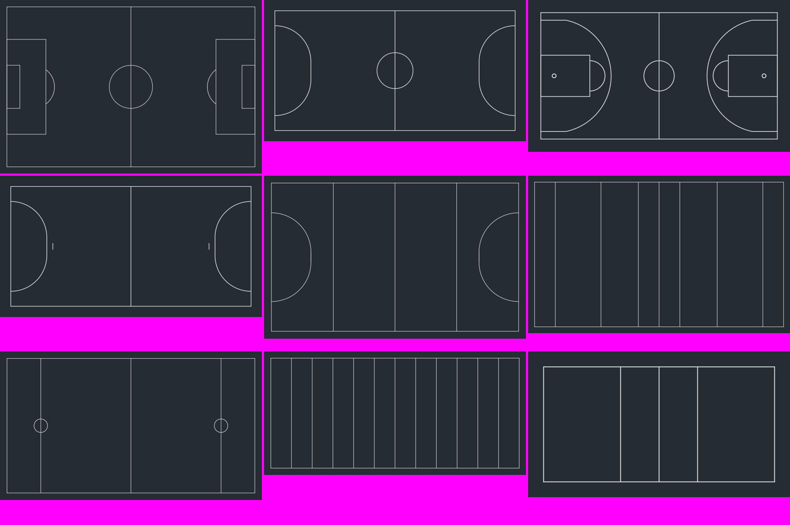

# reco-minimap

**Turn a sports panorama video into a top-down minimap** – players in their shirt colours, referees, the ball, jersey numbers and substitutions – with a browser-based interface, program messages and guides in English, German, French and Spanish.

It is built to work with panoramas from [Reco](https://github.com/reco-project/video-stitcher) (two cameras stitched into one wide picture) and with detection models trained in **Reco Trainer**, but it works on any full-field panorama video plus an RF-DETR ONNX model with the same output layout.

Everything runs locally. No video, frame or model leaves your computer. The only network use is the optional number-model download and the update check, which asks GitHub for the latest version number (switch it off with `--no-update-check`).



| | |
|---|---|
| **Sports** | Football, futsal, basketball, handball, hockey (field), rugby, lacrosse, American football, volleyball, plus a free rectangular field for anything else |
| **Output** | Minimap video, overlay with transparency (for OBS or editing), panorama with detection boxes and minimap, JSON data per frame |
| **Live** | Browser overlay for OBS plus a JSON event stream |
| **Jersey numbers** | Optional OCR on the player's back, constrained to your squad list, with substitution detection |
| **Game situations** | Optional recognition of tip-off, free throw, throw-in, kick-off, corner, penalty, 7 m throw and basketball 2/3-point attempts, from formations on the field ([per sport](docs/SCENARIOS.md)) |
| **Interface** | `reco-minimap ui` – six steps from model import to evaluation, with a notice when a newer version is available |

> **Status:** the pipeline, interface, calibration, tracking and live mode are tested end to end. Detection quality with a real Reco Trainer model was checked on basketball footage only; the other sports are supported by their field geometry. Jersey-number reading has only been measured on synthetic digits (see [Jersey numbers](#jersey-numbers-and-substitutions)). Details in [Known limitations](#known-limitations).

---

## Contents

1. [How it works](#how-it-works)
2. [Install](#install)
3. [Quick start](#quick-start)
4. [Sports](#sports)
5. [Models from Reco Trainer](#models-from-reco-trainer)
6. [Jersey numbers and substitutions](#jersey-numbers-and-substitutions)
7. [Game situations (scenes)](#game-situations-scenes)
8. [Live mode and OBS](#live-mode-and-obs)
9. [Command-line reference](#command-line-reference)
10. [Output formats](#output-formats)
11. [Project folder](#project-folder)
12. [Performance](#performance)
13. [Known limitations](#known-limitations)
14. [Use as a Rust library](#use-as-a-rust-library)
15. [Development](#development)
16. [License and credits](#license-and-credits)

Step-by-step guides: [Walkthrough (English)](docs/WALKTHROUGH.md) · [Anleitung (Deutsch)](docs/WALKTHROUGH.de.md) · [Guide (Français)](docs/WALKTHROUGH.fr.md) · [Guía (Español)](docs/WALKTHROUGH.es.md) · Game situations per sport: [Scenarios (English)](docs/SCENARIOS.md) · [Szenarien (Deutsch)](docs/SZENARIEN.de.md) · [Scénarios (Français)](docs/SCENARIOS.fr.md) · [Escenarios (Español)](docs/SCENARIOS.es.md)

---

## How it works

```
panorama video ──► tiles (sized by distance) ──► RF-DETR detector (ONNX Runtime, CoreML on Mac)
                                                          │
        field calibration (click landmarks) ──► homography panorama → field metres
                                                          │
         team colours ──► tracker: Kalman filter + Hungarian matching, fixed player slots,
                          plausible motion when a player is hidden, ball state machine
                                                          │
              (optional) number reader ──► jersey votes ──► substitutions
                                                          │
                  renderer ──► minimap video / transparent overlay / panorama + minimap / JSON / live overlay
```

* **Tiling.** A panorama is much wider than the detector's 512 px input, and players far from the camera are small. `reco-minimap scales` measures how tall players appear at each image row and `--tile auto` then cuts each band with the tile size that makes a player about 28 px tall for the model. With a calibration the bands cover the field from the far to the near sideline and only span the part of the picture where the field is, so stands and ceiling are not searched. All depth bands are covered (there is no band limit any more), and `--roi` also restricts `--tile auto`; see [tiling fix and benchmark (German)](docs/TILING_FIX.de.md).
* **Calibration.** You click known field points (corners, centre, penalty-area corners …) once per camera position; a small top-down field shows which one is asked for. The program fits a homography from panorama pixels to field metres and shows the field lines over the picture so you can judge the fit; it reports the error in metres.
* **Two confidence levels.** Only confident player detections start a dot or bring back a lost one; weaker ones are used to keep following a player who is already tracked.
* **Tracking.** Each team has a fixed number of slots (5 for basketball, 11 for football …). Both teams are matched in one step: the shirt colour decides between candidates, but a detection right where a player is expected stays his even if one colour sample disagrees. A hidden player keeps moving with damped velocity and cannot leave the field; a returning player re-takes his slot instead of creating a sixth dot.
* **Ball.** States *held*, *in flight*, *loose* and *unknown*. For hand-control sports, a ball hidden in hands stays *held* for a configurable grace period (default 1.5 seconds), then becomes *unknown*. Other sports do not infer individual possession from body-box overlap. Detections far from the tracked ball are ignored unless they are clearly confident; a ball that does not move for 3 s (a spare ball beside the court) is ignored.
* **Smooth video.** Detection can run on every Nth frame (`--every N`); the minimap video is still written at the full frame rate by interpolating between detections.

## Install

### Requirements

| | |
|---|---|
| Rust | stable toolchain, built and tested with **1.91** |
| ffmpeg + ffprobe | on your `PATH` (`brew install ffmpeg`) |
| ONNX Runtime | shared library **1.24 or newer** (see below) |
| A detection model | an RF-DETR ONNX export, e.g. from Reco Trainer |

Tested on macOS (Apple silicon, M4 Pro). The code is portable and the test suite runs on Linux; Windows is untested.

### macOS

```bash
brew install ffmpeg

# ONNX Runtime with the CoreML provider: take the library from the Python wheel.
# (The Homebrew onnxruntime package does not include CoreML.)
python3 -m venv ~/ortvenv
~/ortvenv/bin/pip install onnxruntime
find ~/ortvenv -name "libonnxruntime*.dylib"            # note the path

export ORT_DYLIB_PATH="$HOME/ortvenv/lib/python3.14/site-packages/onnxruntime/capi/libonnxruntime.1.30.0.dylib"

# build and install
cargo install --path . --features tools,coreml
reco-minimap --help
```

Put the `export ORT_DYLIB_PATH=…` line into `~/.zshrc` so it survives new terminal windows. If the variable is missing, the program tells you instead of hanging.

If you cannot use CoreML, build with `--features tools` and pass `--ep cpu` (about 9× slower on an M4 Pro).

### Linux

```bash
sudo apt install ffmpeg
python3 -m venv ~/ortvenv && ~/ortvenv/bin/pip install onnxruntime
export ORT_DYLIB_PATH=$(find ~/ortvenv -name "libonnxruntime.so*" | head -1)
cargo install --path . --features tools
```

### Optional: number model

```bash
reco-minimap fetch-ocr        # one-time download, about 11 MB
```

## Quick start

```bash
reco-minimap ui               # opens http://127.0.0.1:8788/
```

1. **Sport & model** – pick the sport, import the folder exported by Reco Trainer.
2. **Video** – choose the full panorama (not the AI-cropped view).
3. **Calibration** – click the field landmarks, measure player sizes, detect shirt colours.
4. **Process** – choose segments and outputs, press *Start*.
5. **Live** (optional) – start the browser overlay for OBS.
6. **Evaluation** – numbers about a finished run.

Results land in `<project folder>/out/` (default project folder: `~/reco-minimap-projekte/standard`).

New here? The [walkthrough](docs/WALKTHROUGH.md) explains how the program is meant to be used: set up once per venue, then process each game, starting with a short trial run.

### Updating

```bash
reco-minimap update           # is there a newer version on GitHub?
reco-minimap update --yes     # build and install it (needs the Rust toolchain; takes a few minutes)
```

The interface runs the same check when it starts and shows a notice with an *Install now* button. Nothing is installed without that click or `--yes`. Restart the program afterwards.

## Sports

Profiles carry the field size, line markings, calibration landmarks, team size, referee slots and speed limits. Dimensions are the common international standards; real venues often differ slightly, and calibration scales the corners to your field.

| id | Sport | Field (m) | Players per team | Referee slots |
|---|---|---|---|---|
| `football` | Football (soccer) | 105 × 68 | 11 | 3 |
| `futsal` | Futsal | 40 × 20 | 5 | 2 |
| `basketball` | Basketball (FIBA) | 28 × 15 | 5 | 2 |
| `handball` | Handball | 40 × 20 | 7 | 2 |
| `hockey` | Hockey (field) | 91.4 × 55 | 11 | 2 |
| `rugby` | Rugby union (incl. 2 × 10 m in-goal) | 120 × 70 | 15 | 3 |
| `lacrosse` | Lacrosse, men's field | 100.6 × 54.9 | 10 | 3 |
| `american_football` | American football (incl. end zones) | 109.7 × 48.8 | 11 | 7 |
| `volleyball` | Volleyball | 18 × 9 | 6 | 2 |
| `custom` | Any other sport: rectangle with halfway line and centre circle | you set it | you set it | you set it |

Ice hockey is not included yet. A new sport needs one function in [`src/sport.rs`](src/sport.rs) (lines and landmarks) and its name in `scripts/gen_i18n.py`.

## Models from Reco Trainer

A Reco Trainer export is a folder with `runtime.json`, `model-card.json` and an `.onnx` file. In the interface choose *Choose folder and import …*; on the command line:

```bash
reco-minimap import-model /path/to/export --to ~/reco-minimap-projekte/standard/models
```

The import

* verifies the SHA-256 of the weights against `model-card.json` / `runtime.json` and **refuses a damaged file**,
* reads sport, classes and input size,
* copies the model into the project (an existing import is never overwritten),
* selects the sport automatically when the model names one (`soccer`, `fussball`, `field_hockey` … are recognised).

A bare `.onnx` file works too; a `runtime.json` with the default classes is generated.

**Expected model layout** (`rf-detr-imagenet-v1`): input `input` `[1,3,512,512]` (RGB, ImageNet normalisation), outputs `dets [1,300,4]` (normalised `cx cy w h`) and `labels [1,300,N]` (class logits, sigmoid). Classes are taken from `runtime.json` (`ball`, `player`, `referee`, `ignore`; `goalkeeper` counts as player, `puck` as ball).

## Jersey numbers and substitutions

```bash
reco-minimap fetch-ocr
reco-minimap run pano.mp4 --model … --court court.json --teams teams.json \
    --numbers --roster-home 4,7,10,12,23 --roster-away 3,6,8,15,9 [--hires pano_large.mp4]
```

* The number is searched in the upper torso crop (the region that differs most from the shirt colour) and read by the PP-OCRv4 recognition network. **With a squad list the reader only chooses among those numbers**, which is far more reliable than free reading.
* Readings are collected as votes per player slot. A number is shown only after several consistent reads and stays until someone else's evidence wins; uncertain reads stay empty instead of guessing.
* `--hires` reads numbers from a higher-resolution export of the same panorama (same timeline); detection keeps using the smaller video.

**Resolution decides.** Measured on synthetic digits with rotation, blur, fabric folds and heavy compression:

| digit height | correct, free reading | correct, with 14-number squad |
|---|---|---|
| 6 px | 25 % | 43 % |
| 8 px | 83 % | 90 % |
| 10 px | 92 % | 92 % |
| 12 px and up | 95–100 % | 100 % |

Confident reads (≥ 0.8) were 100 % correct from 8 px up. A back number is roughly 12 % of the player's height, so you need players of about **80 px or more**. At the end of every run the program prints how tall players are in your source and whether that is enough. Real jerseys are harder than synthetic ones, so treat these numbers as optimistic.

**Substitutions** are reported when

1. the confirmed number of a slot changes (`#7 → #12`), or
2. a player was last tracked within 1.5 m of a sideline (the long sides), was gone for at least 3 s, and someone appears within 2 m of a sideline – a *possible* substitution; if the same number comes back, nothing is confirmed. Players hidden in a crowd or under the basket, and moments when several slots drop out at once, are not reported; a slot reports at most once in 20 s.

They appear in the log, in `events` of every JSON record, in `reco-minimap stats` and as a banner in the live overlay.

## Game situations (scenes)

```bash
reco-minimap run pano.mp4 … --scenes          # also: live … --scenes, or the checkbox in the interface
```

Dead-ball formations are easy to see from tracked positions: players stand in characteristic places and hardly move. reco-minimap recognises, per sport:

| Sport | Recognised |
|---|---|
| Basketball | tip-off · free throw · throw-in (inbound) · substitution · 2- and 3-point attempts (needs the ball) |
| Football | kick-off · penalty · corner · throw-in · substitution |
| Futsal | kick-off · kick-in · corner · penalty · substitution |
| Handball | throw-off · 7 m throw · throw-in · substitution |
| Hockey (field) | centre pass · penalty stroke · substitution |
| Rugby · Lacrosse | kick-off · face-off |

Each scene must hold for 1–2 s before it fires, and fires once per formation. Events carry team, side, position and a confidence; they appear in the log, in `events` of the JSON records (`"type": "scene"`), in `stats` and as a banner in the live overlay.

* **2/3-point attempts** fire when the ball leaves the shooter's hands towards a basket and are classified by the release position; they are flagged `borderline` within the position error of the arc. Whether the shot went in is **not** detected.
* The full catalogue, including what is feasible but not implemented (timeouts, free-kick walls, scrums, snap formations …) and what is not possible from positions, is in **[docs/SCENARIOS.md](docs/SCENARIOS.md)**.
* **Verified on constructed formations only** – positive cases and the look-alikes that must not fire. Expect to tune thresholds on real games.

## Live mode and OBS

```bash
reco-minimap live <source> --model … --court court.json --teams teams.json \
    --size 1920x1080 --fps 25 [--numbers …]
```

`<source>` is anything ffmpeg can read: a file (use `--realtime` to play it at native speed), `srt://…`, `rtmp://…`, `udp://…`, a growing file (`file:live.mkv --in-args '-follow 1'`), a capture device.

* **OBS:** add a *Browser* source with `http://127.0.0.1:8765/`, width 1400, height 800. The background is transparent.
* Detection runs as fast as it can (about 2–3 updates per second on an M4 Pro); the page predicts player movement from position and velocity and draws at the browser's frame rate.
* Data for other programs: `/events` (server-sent events) and `/state.json`.
* URL parameters: `?floor=1` dark floor for testing, `?lead=0.2` predict further ahead (negative = less, to match the stream delay), `?minalpha=1`, `?debug=1`.
* Use `--host 0.0.0.0` to reach it from another computer.

Opt-in `--adaptive-live` selects tiles near recent observations between full
searches (`--sweep-secs 2`). Four rotating recovery tiles per update also search
away from known players (`--ball-search-tiles 4`, `0` disables this). Live OCR
runs in a bounded background worker (`--ocr-secs 2`), rejecting stale/reused-track
results. `--workers 2` enables parallel model sessions; worker count is also
selectable in the UI. The JSON `performance` object reports
tile counts, inference time and dropped frames; `?debug=1` displays the counters.
This prioritizes fresh updates, **not exhaustive frame processing**. Latency is
measured from decoded-frame arrival, not from the camera. Adaptive search can
miss fast objects between sweeps; it remains experimental and does not affect
`run`. See [implementation and limitations](docs/ADAPTIVE_LIVE.de.md).

Important: the minimap needs the **same full panorama you calibrated on**. The AI-panned view that `reco camera` writes is a moving crop and cannot be used.

## Command-line reference

| Command | Purpose |
|---|---|
| `ui` | Browser interface (`--port 8788`, `--no-open`, `--no-update-check`) |
| `calibrate <video>` | Click field landmarks → `court.json` (`--sport`, `--time`, `--lang`; custom: `--length --width --team-size --referees`) |
| `selfcheck <video> --model …` | Run the model on sample frames and report players per frame, ball hits, speed (`--annotate dir` writes marked PNGs) |
| `scales <video> --model …` | Measure player size per image row → `scales.json` for `--tile auto` |
| `colors <video> --model …` | Detect the two shirt colours → `teams.json` |
| `run <video> --model …` | Process a video → minimap / overlay / panorama+minimap / JSON |
| `live <source> --model …` | Live overlay and data stream |
| `replay <detections.jsonl> --court … --teams …` | Re-run tracking, ball and game situations from recorded detections (`run … --dets file`), without the video: seconds instead of minutes. Byte-identical to the run it was recorded from; use it to compare `--thr-player`, team colours or tracker changes |
| `stats <states.jsonl>` | Numbers about a run: slots, jumps, ball states, substitutions |
| `import-model <path> --to <dir>` | Verify and copy a Reco Trainer model |
| `fetch-ocr` | Download the number-reading model |
| `update` | Look for a newer version on GitHub (`--check` only reports, `--yes` builds and installs it) |
| `ocr-bench <manifest.tsv>` | Measure the number reader on your own crops |

Common options (see `reco-minimap --help` for all):

| Option | Meaning |
|---|---|
| `--tile auto` / `512` / `512,1024` | Tile sizes; `auto` needs `scales.json` |
| `--every N` | Detect on every Nth frame (output stays at full frame rate) |
| `--start T` with `--end T` or `--duration T` | Process only a section of a longer video. `T` is seconds, `min:s` or `h:min:s`, e.g. `--start 12:30 --end 22:30`. Also applies to `selfcheck`, `scales` and `colors` |
| `--dets f.jsonl` | Record the detections of `run` for `replay` (record with a low `--thr-player`, e.g. 0.3, to compare thresholds later) |
| `--ep coreml\|cpu`, `--units all\|gpu\|ane\|cpu` | Execution provider (on M-series `all` ≈ `gpu`; the Neural Engine did not help for this model) |
| `--scenes` | Recognise game situations (throw-in, free throw, kick-off, penalty, corner, 7 m, 2/3-point attempts …) |
| `--numbers --roster-home … --roster-away … --hires …` | Read jersey numbers and detect substitutions |
| `--thr-player 0.60 --thr-ball 0.30 --thr-ref 0.50` | Detection thresholds (defaults shown) |
| `--thr-player-low 0.30` | (`run`, `live`, `replay`) Player detections between this value and `--thr-player` keep an existing dot going but never start one. A model that is unsure in a crowd then still follows the players, without its false positives becoming players. Set it equal to `--thr-player` to turn this off |
| `--roi x0,y0,x1,y1` | Search only a band of the panorama (fractions) |
| `--minimap f.mp4 --alpha f.mov --pip f.mp4 --json f.jsonl` | Outputs of `run` (`--alpha-bg 0.6` adds a dark backing) |
| `--draw-home #fff --draw-away #2f6bff --ref-color #000` | Display colours, referee shirt colour |
| `--min-alpha 1` | Keep undetected players fully opaque (default 0.8) |
| `--lang de\|en\|fr\|es` | Language of all messages (default: `RECO_MINIMAP_LANG`, else the system language, else English) |
| `--torso 0.18,0.50` | Part of a player box (top, bottom as shares of its height) that shows the shirt; adjust for figures with other proportions (`colors`, `run`, `live`) |
| `--shirt-match` | Take the torso colour from the pixels that match a known shirt colour. Helps with strong, distinct colours and with court areas painted in a team colour; leave off for light against dark |
| `--referees N` | Number of referee slots (default from the calibration); `0` for a game without referees |
| `--no-field-mask` | With `--tile auto`: tile the full picture width and only the measured rows instead of following the calibrated field |

> Interface, program messages and `--help` are available in German, English, French and Spanish. `--lang de|en|fr|es` selects the language of the messages; without it the program follows `RECO_MINIMAP_LANG`, then the system language, then English. The interface passes its own language to every job it starts.

`scripts/run_game.sh` processes a whole game in segments (for example quarters) and can composite the minimap into a broadcast video with ffmpeg.

## Output formats

`--json` writes one JSON object per processed frame (JSON lines). Coordinates are metres in field space: `x` along the length from the left, `y` along the width from the far sideline.

```json
{
  "t": 2.9,
  "players": [
    {"id": 1, "team": "home", "x": 8.0, "y": 3.0, "vx": 0.0, "vy": 0.0,
     "state": "visible", "alpha": 1.0, "jersey": 7}
  ],
  "referees": [
    {"id": 8, "team": "none", "x": 13.0, "y": 7.9, "vx": 0.0, "vy": 0.0,
     "state": "visible", "alpha": 1.0, "jersey": null}
  ],
  "ball": {"state": "held", "holder": 3, "x": 12.0, "y": 9.2, "vx": 0.0, "vy": 0.0},
  "events": [
    {"type": "sub", "kind": "confirmed", "team": "home", "slot": 3, "out": 7, "in": 12, "t": 512.34}
  ]
}
```

* `id` is a **slot**, not a person. Pair it with `segment` to identify a continuous tracking section. `identity.status` is `unknown`, `candidate` or `conflict`; `identity.player` contains a provisional `{team, number}` key or `null`. `state` is `visible`, `occluded` or `lost` (position then is an estimate).
* `ball.state`: `held` (with `holder`), `flight`, `loose`, `unknown`.
* `events.kind`: `confirmed` (fresh number differs after re-entry; still a heuristic) or `possible` (leave and re-enter at a sideline). An OCR correction without re-entry no longer emits a substitution.
* Live records additionally carry `age_ms` (time from camera frame to result).

## Project folder

```
<project>/
  project.json     settings of the interface
  court.json       calibration (sport, field size, landmark pairs, error)
  scales.json      player size by image row
  teams.json       detected shirt colours
  models/          imported models
  out/             results
```

## Performance

Measured on a Mac with an M4 Pro, 2560×1440 panorama, RF-DETR small, one minute of basketball at every 10th frame:

| | |
|---|---|
| Per tile | CoreML ≈ 20 ms (CPU ≈ 207 ms, measured earlier on 1920×1080) |
| Tiles per frame | 15 with `--tile auto` and a calibration; 23 without the calibration (full picture width) |
| Per processed frame | ≈ 306 ms, of which more than 95 % is inference |
| Throughput | ≈ 3.2 processed frames per second → a 10-minute quarter at 60 fps and `--every 10` takes about 19 minutes |
| Parallel model sessions | no gain (the accelerator works one tile at a time) |

Lower cost with `--every N` and by keeping the calibration current, so that only the field is searched. `replay` re-runs everything after the detector from recorded detections in well under a second per minute of video.

## Known limitations

* **Referees and ball** are the weakest detections with the model we tested. Referees are therefore also found by shirt colour (`--ref-color`); the ball is tracked with hysteresis and stays *unknown* when unsure. Better training data (balls of 12–15 px, referees) improves this more than any code change.
* **A flying ball** is projected onto the floor, so its dot is displaced.
* **Calibration** is a planar homography. Strongly curved stitches grow errors towards the edges; the page shows the error in metres.
* **Jersey numbers** are measured on synthetic digits only and need large players (see above). Substitutions rely on numbers or on leaving and re-entering at a sideline; with neither, a swap on the field cannot be told.
* **Team colours** come from one colour sample per player. Automatic colour detection assumes people in shirts; for unusual figures or kits set the colours by hand. A player in front of court paint in the other team's colour can be assigned to the wrong team (`--shirt-match` reduces this for strong colours).
* **The detector decides.** On the footage we measured, about 4 of 10 players per frame reach the 0.60 confidence and about 8 reach 0.30. Tracking follows players on the weaker detections, but which player a dot belongs to after a scramble cannot be checked without jersey numbers or annotated frames.
* **Updates** build from source with `cargo`, so they need the Rust toolchain and a few minutes. No signed binaries are published.
* **Game situations** are rule-based and verified on constructed formations only. Ball-dependent ones (2/3-point attempts) fire only when the ball is tracked at the right moment, and whether a shot scored is not detected. Throw-ins can false-trigger when a player happens to stand still at the line during play.
* **Detection of other sports** was not tested with trained models; the field geometry is.
* Live input from real SRT/RTMP sources and the Neural Engine path are untested; a growing `.mkv` follows with a latency set by the muxer's cluster length.
* This README is in English only. The walkthrough and the scenario catalogue exist in all four languages and include the installation steps.

## Use as a Rust library

The core (`reco_minimap`, no dependencies) takes detections and gives you tracked state; the tools (`--features tools`) add video I/O, ONNX inference, the interface and the commands.

```rust
use reco_minimap::{Config, Minimap};
use reco_minimap::detect::{Class, Det};
use reco_minimap::geom::{HomographyProjector, Vec2};
use reco_minimap::sport::SportProfile;

let profile = SportProfile::football();
let projector = HomographyProjector::calibrate(&panorama_points, &field_points).unwrap();
let mut minimap = Minimap::new(Config::for_sport(&profile, home_rgb, away_rgb), Box::new(projector));

// detections in normalised panorama coordinates (cx, cy, w, h)
let state = minimap.process(t_seconds, &detections);
for p in &state.players { /* p.id, p.team, p.pos (metres), p.jersey */ }
```

Implement `geom::Projector` on top of your own panorama projection if a plain homography is not accurate enough.

## Development

```bash
cargo test --features tools              # 50 tests (core, tools, number decoding, substitutions, game situations, tiling, update check, languages)
python3 scripts/gen_i18n.py              # regenerate src/tools/i18n.js (all keys in all 4 languages)
                                         # program messages: tr!/trs! carry de, en, fr, es at the call site (src/tools/i18n.rs)
python3 scripts/make_test_assets.py      # synthetic panorama + stand-in ONNX for smoke tests
python3 scripts/coreml_probe.py <model>  # CoreML partitions and per-unit timing
node scripts/ui_test.js                  # drives the interface in jsdom (see the header of the file)
cargo run --example sports_sheet /tmp    # draw all field layouts
```

Layout: `src/` core library (geometry, sport profiles, detection decoding, tracker, ball, numbers, game situations, renderer); `src/tools/` video I/O, inference, calibration page, interface, live hub, number reader; `src/bin/reco-minimap.rs` commands.

## License and credits

* reco-minimap is released under the **GNU AGPL-3.0**, the same license as the Reco workspace it is designed to join (see [LICENSE](LICENSE)).
* The number-reading model is the **PP-OCRv4** recognition network from [PaddleOCR](https://github.com/PaddlePaddle/PaddleOCR), ONNX export from [RapidOCR](https://github.com/RapidAI/RapidOCR), **Apache-2.0**. It is downloaded on request, not bundled.
* Detection models come from [Reco Trainer](https://reco.cam); check that you have the rights to the training material before sharing weights.
* Built on [ONNX Runtime](https://onnxruntime.ai) through the [`ort`](https://github.com/pykeio/ort) crate and [ffmpeg](https://ffmpeg.org).

## Architecture update

Sport-specific scene and possession policies are now explicit and separate from
field geometry. Unsupported sports no longer inherit throw-in events or hand
possession; unseen hand possession expires after a configurable timeout (1.5 s
by default). See [architecture and migration notes (German)](docs/ARCHITECTURE.de.md)
for implemented boundaries, compatibility and the remaining roadmap.

Identity output now separates reusable tracking slots (`id`), continuous segments
(`segment`) and provisional team/number candidates (`identity`). Re-acquired slots
require fresh OCR evidence; duplicate teammate numbers are reported as conflicts
instead of being displayed as certain identities. These are candidates, not full
person re-identification. See the migration notes above for Rust API additions.

Offline roster names and segment/time-scoped manual corrections are available via
`review-identities states.jsonl --annotations review.json --out reviewed.jsonl`.
The source stays unchanged and is verified by SHA-256. See
[identity review instructions (German)](docs/IDENTITY_REVIEW.de.md). This currently
updates JSONL without re-rendering videos. The **Review** link in the browser UI
now opens a local video/map player, event navigation and roster/correction editor.
It exports the same annotation document for the CLI; see the instructions above
for browser limits, time alignment and saving your edits.
