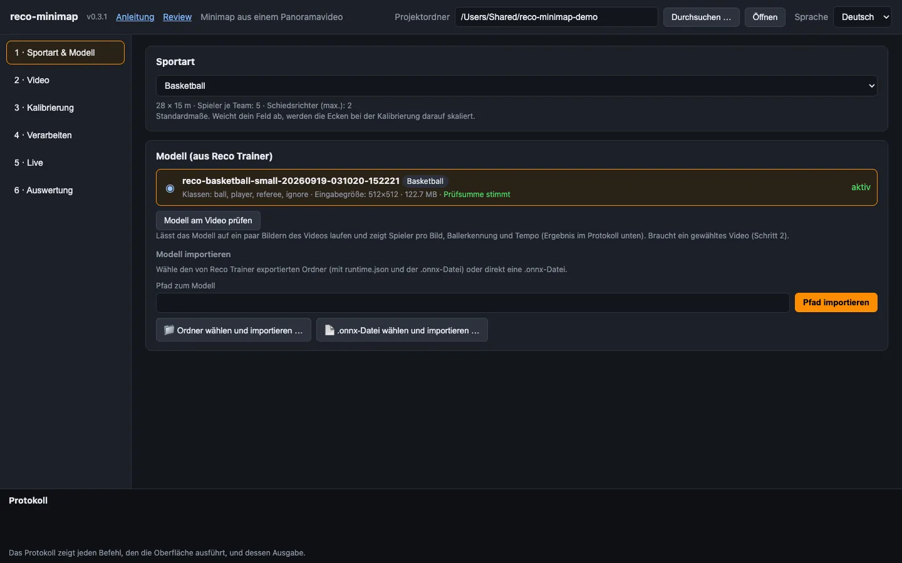
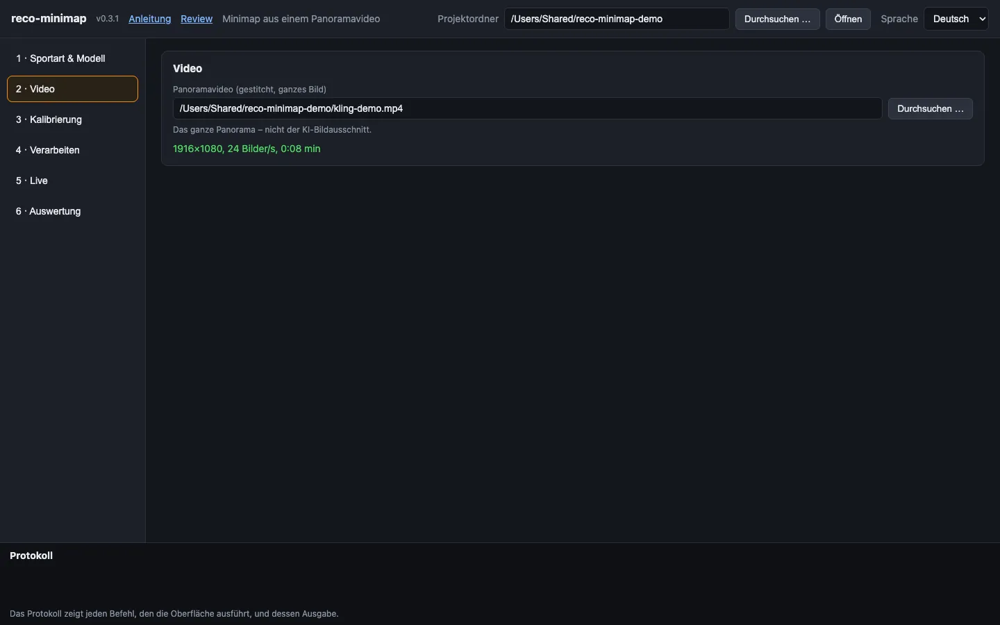
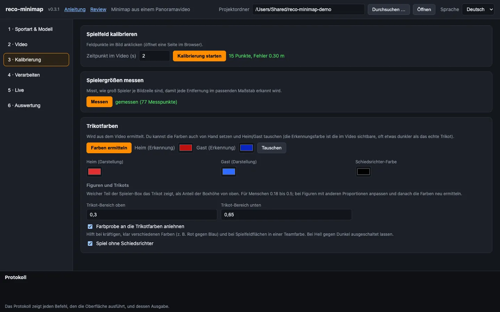
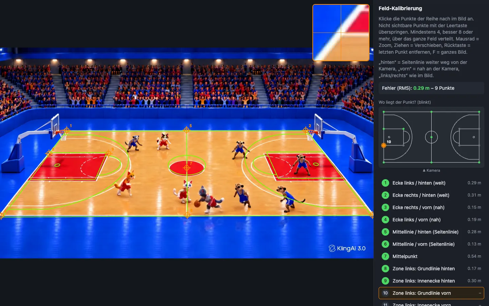
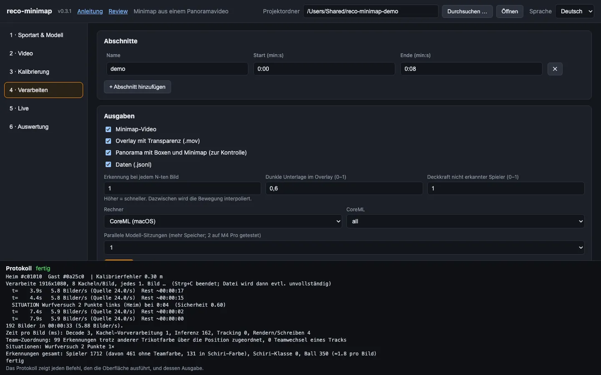
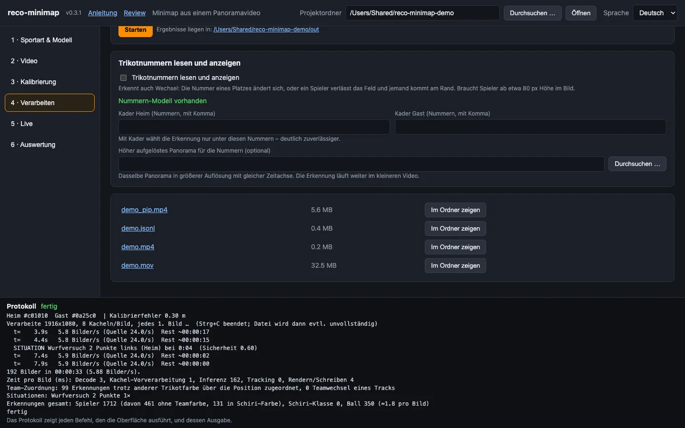
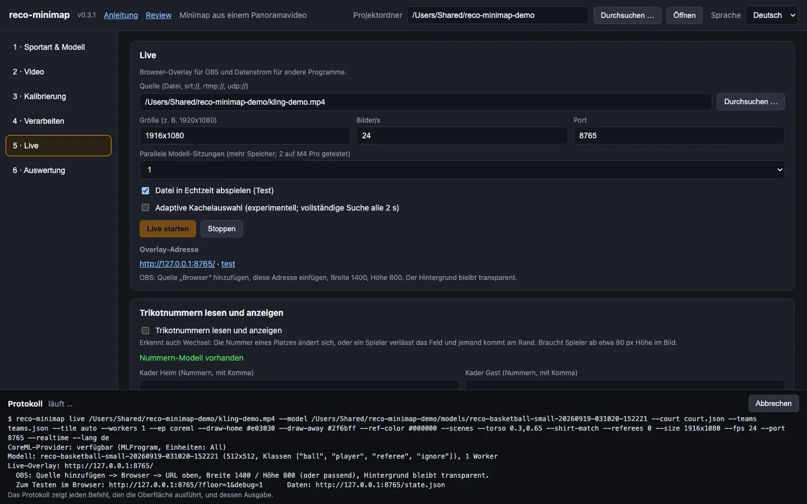
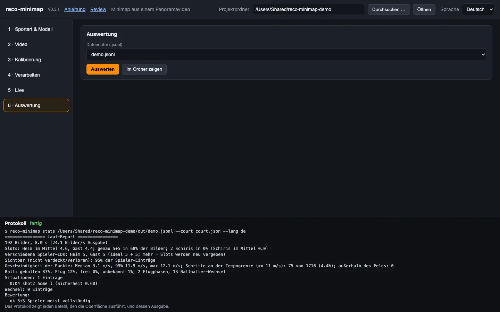

# Anleitung: von zwei Kameravideos zur Minimap

Diese Anleitung führt dich von „Ich habe ein Panoramavideo und ein trainiertes Modell“ bis zu „Ich habe ein Minimap-Video“. Sie folgt den sechs Schritten der Oberfläche. Beim ersten Mal brauchst du etwa 30 Minuten; bei späteren Spielen sind es wenige Minuten Klicken plus Rechenzeit.

<p> </p>

**So sieht das Ergebnis aus:** die ersten acht Sekunden eines animierten Testvideos (rote Katzen gegen blaue Erdmännchen). Links das Kontrollvideo mit Boxen und eingeblendeter Minimap, rechts die Minimap allein. Als Video: [Kontrollvideo (MP4)](media/demo-pip.mp4) · [Minimap (MP4)](media/demo-minimap.mp4). Alle Bilder dieser Anleitung stammen aus diesem Testprojekt.

**Das brauchst du vorher**

* Das installierte Programm, siehe [Installation](#installation) unten.
* Ein **Panoramavideo des ganzen Spielfelds** – das gestitchte Bild aus Reco, **nicht** der KI-Bildausschnitt. Hast du nur ein linkes und ein rechtes Video, stitche sie zuerst mit Reco. Für die Minimap reicht ein Export mit 1920×1080; für Trikotnummern brauchst du einen größeren (siehe Schritt 4).
* Ein **Modell aus Reco Trainer** (Ordner mit `runtime.json`, `model-card.json` und einer `.onnx`-Datei).
* Optional: die Rückennummern beider Kader, wenn Nummern auf den Scheiben stehen sollen.

Oberfläche starten:

```bash
reco-minimap ui
```

Der Browser öffnet `http://127.0.0.1:8788/`. Oben rechts wählst du die Sprache (Deutsch · English · Français · Español); die Meldungen des Programms im Protokoll folgen dieser Wahl. Oben stehen auch der **Projektordner** – dort liegt alles zu einer Halle oder Saison. Standard ist `~/reco-minimap-projekte/standard`; mit *Durchsuchen …* wählst du einen anderen.

> Tipp: Nimm pro Halle und Kameraposition einen eigenen Projektordner. Die Kalibrierung hängt davon ab, wo die Kamera steht.

## Installation

| | |
|---|---|
| Rust | stabile Toolchain (gebaut und getestet mit **1.91**) |
| ffmpeg + ffprobe | im `PATH` (`brew install ffmpeg`) |
| ONNX Runtime | dynamische Bibliothek **1.24 oder neuer** |
| Ein Erkennungsmodell | ein RF-DETR-Export im ONNX-Format, z. B. aus Reco Trainer |

**macOS**

```bash
brew install ffmpeg
python3 -m venv ~/ortvenv
~/ortvenv/bin/pip install onnxruntime
find ~/ortvenv -name "libonnxruntime*.dylib"
export ORT_DYLIB_PATH="<der angezeigte Pfad>"
cargo install --path . --features tools,coreml
```

Die Bibliothek aus dem Python-Paket enthält CoreML, die von Homebrew nicht. Trage die Zeile `export ORT_DYLIB_PATH=…` in `~/.zshrc` ein, damit sie in neuen Terminalfenstern gilt.

**Linux**

```bash
sudo apt install ffmpeg
python3 -m venv ~/ortvenv && ~/ortvenv/bin/pip install onnxruntime
export ORT_DYLIB_PATH=$(find ~/ortvenv -name "libonnxruntime.so*" | head -1)
cargo install --path . --features tools
```

Getestet auf macOS (Apple Silicon); die Tests laufen unter Linux; Windows ist ungetestet.

## So ist die Bedienung gedacht

Die Arbeit teilt sich in zwei Teile: **einmal einrichten**, dann **pro Spiel verarbeiten**.

**Einmal pro Halle und Kameraposition** (Schritte 1 bis 3)

1. Sportart wählen und das Modell importieren.
2. Ein Panoramavideo aus dieser Halle wählen.
3. Kalibrieren: Feldpunkte anklicken, Spielergrößen messen, Trikotfarben festlegen.

Das Ergebnis liegt im Projektordner (`court.json`, `scales.json`, `teams.json`) und gilt, solange die Kamera am selben Platz steht und das Panorama gleich exportiert wird. Ändert sich eines davon, wiederholst du Schritt 3.

**Pro Spiel** (Schritte 2, 3c, 4 und 6)

1. Das neue Video wählen (Schritt 2).
2. Die Trikotfarben neu ermitteln oder von Hand setzen, wenn andere Teams spielen (Schritt 3c).
3. Einen **kurzen Probelauf** von 20 bis 60 Sekunden mit dem Kontrollvideo machen und ansehen (Schritt 4).
4. Passt es, das ganze Spiel in Abschnitten verarbeiten.
5. Die Zahlen in Schritt 6 ansehen, wenn dir etwas seltsam vorkommt.

**Was das Programm selbst entscheidet und was du vorgibst**

* Es findet Spieler, Schiedsrichter und Ball, verfolgt sie und hält pro Team eine feste Zahl von Plätzen. Ein verdeckter Spieler bleibt an seiner geschätzten Position, statt zu verschwinden.
* Du gibst vor: wo das Feld liegt, welche Farben die Teams tragen und welchen Zeitraum es verarbeiten soll. Diese drei Angaben entscheiden über die Qualität; alles andere hat brauchbare Standardwerte.
* Das Kontrollvideo (*Panorama mit Boxen und Minimap*) ist dein Prüfwerkzeug. Sieh es dir beim ersten Abschnitt an, bevor du ein ganzes Spiel rechnen lässt.

**Unten auf der Seite** steht das Protokoll. Es zeigt jeden Befehl, den die Oberfläche ausführt, und dessen Ausgabe. Alles, was die Oberfläche kann, geht auch auf der Kommandozeile; einige Feineinstellungen gibt es nur dort (`reco-minimap --help`).

**Neue Versionen** meldet die Oberfläche oben mit einem blauen Hinweis, siehe [Aktualisieren](#aktualisieren).

---

## Schritt 1 · Sportart & Modell

1. **Sportart wählen.** Die Liste entspricht Reco Trainer. Die graue Zeile darunter zeigt Feldgröße, Spieler pro Team und Schiedsrichter-Plätze. Für eine Sportart, die nicht in der Liste steht, wähle *Andere Sportart (Rechteckfeld)* und trage Länge, Breite, Spielerzahl und Schiedsrichter ein.
2. **Modell importieren.** Klicke *Ordner wählen und importieren …* und wähle den Ordner aus Reco Trainer (oder *.onnx-Datei wählen und importieren …* für eine einzelne Datei). Du kannst auch einen Pfad eintippen und *Pfad importieren* drücken.
   * Das Programm prüft die Prüfsumme der Gewichte. *Prüfsumme stimmt* ist das Ziel; eine beschädigte Datei wird abgelehnt.
   * Es zeigt Klassen (`ball, player, referee, ignore`), Eingabegröße und die Sportart, für die das Modell trainiert wurde. Nennt das Modell eine Sportart, wird sie für dich gewählt. Weicht sie von deiner Wahl ab, erscheint ein roter Hinweis.
3. **Modell prüfen** (braucht ein Video aus Schritt 2, du kannst also später zurückkommen): *Modell am Video prüfen* lässt das Modell auf ein paar Bildern laufen und schreibt einen Bericht ins Protokoll unten. Darauf achten:
   * *Spieler pro Bild (Median)* nahe der Spielerzahl auf dem Feld (10 beim Basketball). Deutlich weniger heißt: Das Modell übersieht Spieler in dieser Größe – mach trotzdem weiter, Schritt 3 verbessert das.
   * `Wandzeit pro Bild` ist die Zeit pro Bild. Auf einem M4 Pro mit CoreML sind es einige hundert Millisekunden.
   * Es zeigt, ob die Annahmen über die Modellausgabe stimmen („Boxen liegen in 0..1“, „die meisten Treffer liegen auf ‚player‘“).


*Schritt 1: Sportart gewählt, Modell importiert, Prüfsumme stimmt.*

## Schritt 2 · Video

Wähle das **Panoramavideo** (*Durchsuchen …* oder Pfad einfügen). Das Programm liest Größe, Bildrate und Länge und zeigt sie grün an, z. B. `1920×1080, 25 Bilder/s, 20:00 min`. Eine rote Meldung heißt: Die Datei war nicht lesbar – prüfe, ob `ffmpeg` installiert ist.


*Schritt 2: Das Video ist gelesen – Größe, Bildrate und Länge stehen grün darunter.*

## Schritt 3 · Kalibrierung

Die Kalibrierung bringt dem Programm bei, wo das Spielfeld im Bild liegt. Hier passieren drei Dinge, in dieser Reihenfolge.


*Schritt 3 im Überblick: Kalibrierung (15 Punkte, Fehler 0,30 m), gemessene Spielergrößen und die Trikotfarben.*

### 3a · Spielfeld kalibrieren

1. Stelle *Zeitpunkt im Video* auf einen Moment, in dem das **ganze Feld sichtbar** und nicht von Personen verdeckt ist (z. B. Auszeit oder Warm-up).
2. Klicke *Kalibrierung starten*. Im Browser öffnet sich eine Seite mit diesem Bild.
3. **Klicke die Punkte in der Reihenfolge der Liste rechts an** (Ecken, Mittellinie, Mittelpunkt, Zonen-/Strafraum-Ecken …). Die Liste ist in deiner Sprache.
   * „hinten“ und „vorn“ bezeichnen die beiden Seitenlinien (hinten = weiter von der Kamera weg), „links/rechts“ wie im Bild.
   * Du musst nicht alles anklicken. Nicht sichtbare Punkte überspringst du mit der **Leertaste**.
   * Rechts über der Liste zeigt ein **kleines Feld von oben**, wo der gerade verlangte Punkt liegt: Er **blinkt orange**. Schon gesetzte Punkte sind grün, offene grau. Die Kamera steht in dieser Zeichnung unten, „hinten“ ist oben.
   * Mausrad = Zoom, Ziehen = Verschieben, **Rücktaste** = letzten Punkt entfernen, **F** = ganzes Bild. Das kleine Fenster oben rechts vergrößert die Stelle unter dem Mauszeiger.
4. Ab dem 4. Punkt erscheint ein **grünes Feld** über dem Bild, und die Seite zeigt den **Fehler in Metern**. Ergänze Punkte, bis die grünen Linien auf den echten Linien liegen. Ziel: **8 oder mehr Punkte, über das ganze Feld verteilt**, Fehler **unter 0,5 m** (grün). Punkte an verschiedenen Stellen sind wichtiger als hochgenaues Klicken.
5. Klicke *Speichern*. In der Oberfläche steht danach z. B. `15 Punkte, Fehler 0.21 m`.


*Die Kalibrierseite: neun Punkte gesetzt, die grünen Linien liegen auf dem Feld. Rechts blinkt in der kleinen Feldskizze Punkt 10, der als Nächstes dran ist; die Lupe oben zeigt die Stelle unter dem Mauszeiger.*

> Ein Fehler von 0,00 m nach genau vier Punkten sagt nichts – vier Punkte passen immer exakt. Beurteile die grünen Linien und nimm mehr Punkte.

Hat deine Halle kein Standardmaß, klicke nur die vier Ecken (und den Mittelpunkt); die übrigen Punkte setzen ein Standardfeld voraus.

### 3b · Spielergrößen messen

Klicke *Messen*. Das Programm schaut sich etwa ein Dutzend Bilder an und lernt, wie groß ein Spieler in jeder Bildzeile erscheint. Später wird jeder Bildstreifen mit der passenden Kachelgröße durchsucht (`--tile auto`): Die Erkennung wird besser und etwa doppelt so schnell. Es braucht die Kalibrierung aus 3a. Einmal pro Kameraposition.

### 3c · Trikotfarben

1. Klicke *Farben ermitteln*. Das Programm sammelt die Trikotfarben der Spieler auf dem Feld und teilt sie in zwei Teams. Im Protokoll siehst du die gefundenen Farbgruppen.
2. Stelle die Farben ein:
   * **Heim / Gast (Erkennung)** – die Farben, wie die Kamera sie sieht. Sie werden automatisch gesetzt; mit *Tauschen* drehst du Heim und Gast um, falls sie vertauscht sind. Schlägt es fehl („Teams nicht unterscheidbar“), wähle die zwei Farben von Hand mit den Farbfeldern.
   * **Torwart-Trikots** (Fußball, Futsal, Handball, Hockey, Lacrosse) – tragen die Torleute eine andere Farbe als ihr Team, setze den Haken bei *Torwart-Trikots*. *Farben ermitteln* schlägt die Torwartfarben aus dem Torraum vor; ist unsicher, welcher Torwart zu welchem Team gehört, steht das im Protokoll – dann *Torwartfarben tauschen*. Ohne diese Angabe hält das Programm einen Torwart im anderen Trikot für einen Schiedsrichter oder übersieht ihn. Bei Basketball und anderen Sportarten ohne Torwart-Trikots erscheint die Option nicht.
   * **Heim / Gast (Darstellung)** – die Farben, in denen die Scheiben gezeichnet werden. Nimm, was gut aussieht, z. B. Weiß und ein helles Blau. Eine sehr dunkle Farbe ist auf der dunklen Minimap schlecht zu sehen.
   * **Schiedsrichter-Farbe** – die Trikotfarbe der Schiedsrichter (meist Schwarz oder Gelb). Damit findet das Programm Schiedsrichter auch dann, wenn das Modell sie nicht erkennt.
3. **Figuren und Trikots** (nur bei Bedarf ändern):
   * **Trikot-Bereich oben / unten** – welcher Teil der Spieler-Box das Trikot zeigt, als Anteil der Boxhöhe von oben. Für Menschen passt der Standard 0,18 bis 0,5. Bei Figuren mit anderen Proportionen (Maskottchen, Animationen) anpassen und danach *Farben ermitteln* erneut ausführen.
   * **Farbprobe an die Trikotfarben anlehnen** – hilft bei kräftigen, klar verschiedenen Farben (Rot gegen Blau) und wenn Flächen des Spielfelds in einer Teamfarbe gestrichen sind. Bei Hell gegen Dunkel ausgeschaltet lassen: Dort ordnet es mehr Spieler falsch zu.
   * **Spiel ohne Schiedsrichter** – dann wird niemand wegen einer unpassenden Trikotfarbe für einen Schiedsrichter gehalten.


*Trikotfarben und Figuren: Für die Zeichentrickfiguren des Testvideos liegt der Trikot-Bereich tiefer (0,3 bis 0,65), und die Farbprobe lehnt sich an Rot und Blau an.*

## Schritt 4 · Verarbeiten

1. **Abschnitte.** Jede Zeile ist ein Lauf: *Name*, *Start* und *Ende* als `min:s` (oder `h:min:s` oder reine Sekunden). Ein leeres Ende heißt bis zum Schluss des Videos; so lässt sich auch nur ein Teil einer langen Aufnahme auswerten. Ein Spiel in Viertel zu teilen ist sicherer – ein Abbruch kostet ein Viertel, nicht das ganze Spiel. *Abschnitt hinzufügen* fügt eine Zeile hinzu.
2. **Ausgaben** (Häkchen setzen):
   * *Minimap-Video* – die Minimap auf dunklem Hintergrund.
   * *Overlay mit Transparenz (.mov)* – die Minimap mit durchsichtigem Hintergrund, zum Einblenden in einem Schnittprogramm oder OBS. *Dunkle Unterlage im Overlay* (0–1) fügt eine halbtransparente dunkle Fläche hinzu, damit sie auf hellem Bild lesbar bleibt; 0,6 ist ein guter Anfang.
   * *Panorama mit Boxen und Minimap (zur Kontrolle)* – dein Panorama mit Erkennungsboxen und der Minimap in der Ecke. Nutze das, um beim ersten Abschnitt die **Qualität zu prüfen**.
   * *Daten (.jsonl)* – ein Eintrag pro Bild mit allen Positionen ([Format](../README.md#output-formats)).
3. **Erkennung bei jedem N-ten Bild.** 5 ist ein guter Anfang: Die Erkennung läuft bei jedem 5. Bild, das Minimap-Video wird auf volle Bildrate interpoliert und wirkt trotzdem flüssig. Höher ist schneller, niedriger genauer.
4. **Deckkraft nicht erkannter Spieler.** 1 lässt einen verdeckten Spieler voll sichtbar an seiner geschätzten Position; kleinere Werte lassen ihn verblassen.
5. **Rechner.** *automatisch* wählt auf einem Mac CoreML. Lass *CoreML* auf `all`.
6. Klicke **Starten**. Das Protokoll unten zeigt den Fortschritt und am Ende eine Zusammenfassung: verarbeitete Bilder, Erkennungen, Zeit je Stufe. *Abbrechen* stoppt den Lauf.

**Wo sind meine Dateien?** In `<Projektordner>/out/`, benannt nach dem Abschnitt (`abschnitt1.mp4`, `abschnitt1.mov`, `abschnitt1_pip.mp4`, `abschnitt1.jsonl`). Die Liste unter den Einstellungen zeigt die neuesten Dateien mit *Im Ordner zeigen*.

**Mach zuerst einen kurzen Lauf.** Nimm einen Abschnitt von 20–60 Sekunden mit Häkchen bei *Panorama mit Boxen und Minimap*. Öffne `…_pip.mp4` und prüfe:

* Sitzen die Scheiben auf den richtigen Personen und an den richtigen Stellen im Feld? Wenn nicht, braucht die Kalibrierung mehr oder besser verteilte Punkte (Schritt 3a).
* Gibt es Phantom-Scheiben oder springende Scheiben? Ein paar Sprünge sind normal; viele deuten auf eine schlechte Kalibrierung oder zu ähnliche Farben hin.
* Sind die Schiedsrichter markiert? Wenn nicht, prüfe die Schiedsrichter-Farbe (Schritt 3c).

Danach verarbeitest du das ganze Spiel.


*Schritt 4: ein Abschnitt (0:00 bis 0:08), alle vier Ausgaben gewählt. Unten im Protokoll die Zusammenfassung des Laufs.*


*Die fertigen Dateien unter dem Start-Knopf: Der Dateiname öffnet die Datei, *Im Ordner zeigen* markiert sie im Finder, der Ordnerpfad öffnet den Ergebnisordner.*

### Trikotnummern (optional)

In Schritt 4 gibt es den Abschnitt *Trikotnummern lesen und anzeigen*.

1. Klicke einmalig *Modell laden* (etwa 11 MB). Der Status wechselt zu „Nummern-Modell vorhanden“.
2. Trage die **Kadernummern** beider Teams ein, mit Komma getrennt (`4,7,10,12,23`). Die Erkennung wählt dann nur unter diesen Nummern – deutlich zuverlässiger. Bei Fußball, Handball, Hockey u. ä. markierst du die Torleute mit `g` oder `tw` hinter der Nummer (`1g,4,7,12tw`): Ist die Torwartfarbe gesetzt (Schritt 3c), wird die Nummer eines Torwarts nur unter den Torleuten gesucht, die aller anderen nur unter den Feldspielern.
3. Setze das Häkchen bei *Trikotnummern lesen und anzeigen* und lass einen Abschnitt laufen.
4. **Die Größe entscheidet.** Eine Nummer ist ab etwa 10 px Ziffernhöhe lesbar, das heißt Spieler mit etwa **80 px Höhe**. Am Ende des Laufs steht im Protokoll, wie groß Spieler in deinem Video sind und ob das reicht. Wenn nicht, exportiere mit Reco eine größere Version desselben Panoramas (gleiche Zeitachse, gleiche Bildrate) und trage sie bei *Höher aufgelöstes Panorama für die Nummern* ein. Die Erkennung läuft weiter im kleineren Video.
5. Nummern erscheinen auf den Scheiben, sobald sie bestätigt sind. Spieler, deren Rücken nie sichtbar ist, bleiben ohne Nummer.

**Wechsel** erscheinen im Protokoll (`WECHSEL Heim bei 12:34: #7 -> #12` für einen bestätigten Wechsel, „möglicher Wechsel“, wenn jemand das Feld verließ und jemand am Rand hereinkam, die Nummern aber unbekannt sind), in `events` der Datendatei und in Schritt 6.

### Spielsituationen (optional)

Setze das Häkchen *Spielsituationen erkennen* (in Schritt 4, auch in Schritt 5 vorhanden). Das Programm erkennt dann die **Aufstellungen bei Spielunterbrechungen** und im Basketball **Wurfversuche**:

* Basketball: Sprungball/Startball, Freiwurf, Einwurf (Inbound), 2er- und 3er-Versuch, Wechsel.
* Fußball: Anstoß, Elfmeter, Ecke, Einwurf, Wechsel.
* Handball: Anwurf, 7-Meter, Einwurf, Wechsel.
* Futsal, Hockey, Rugby, Lacrosse: siehe den [Katalog je Sportart](SZENARIEN.de.md).

Was du erwarten kannst:

* Eine Situation wird gemeldet, wenn die Aufstellung kurz bestanden hat – z. B. ein Spieler an der Freiwurflinie, drei in der Zone, alle anderen stehen still. Im Protokoll steht dann z. B. `SITUATION Freiwurf links (Heim) bei 12:34 (Sicherheit 0.85)`.
* **Prüfe es zuerst an einem kurzen Abschnitt** und vergleiche mit dem Video. Die Schwellen sind erste Schätzungen; ein Einwurf kann gemeldet werden, wenn ein Spieler einfach an der Linie steht, und eine Situation wird verpasst, wenn viele Spieler nicht erkannt werden.
* **2er- und 3er-Versuche** brauchen den Ball, der beim Abwurf gefunden wird. Sie sagen dir die Art des Versuchs, nicht ob er getroffen hat. Der Hinweis „knapp an der Linie“ heißt: Der Positionsfehler ist so groß wie der Abstand zur 3-Punkte-Linie.
* Die Szenen stehen in der Datendatei als Ereignisse mit `"type": "scene"` und in Schritt 6.

## Schritt 5 · Live (optional)

Der Live-Modus liefert eine transparente Overlay-Seite für OBS, während das Video läuft. Gedacht für Streams; für die Nachbearbeitung nimm das `.mov`-Overlay aus Schritt 4.

1. *Quelle*: eine Datei oder eine Stream-Adresse (`srt://…`, `rtmp://…`, `udp://…`). Für einen ersten Test wähle eine Videodatei und setze das Häkchen *Datei in Echtzeit abspielen*.
2. Trage *Größe* (z. B. `1920x1080`) und *Bilder/s* ein. Den Port (8765) lässt du, außer er ist belegt.
3. Klicke *Live starten*. Die Seite zeigt die Overlay-Adresse, z. B. `http://127.0.0.1:8765/`.
4. **In OBS:** Quelle *Browser* hinzufügen, Adresse einfügen, Breite 1400 und Höhe 800. Der Hintergrund bleibt transparent.
5. Öffne die Adresse mit `?floor=1&debug=1` in einem normalen Browser, um ohne OBS zu testen (dunkler Boden, Statuszeile).
6. *Stoppen* beendet es.

Der Live-Modus braucht dasselbe ganze Panorama, auf dem du kalibriert hast, nicht den KI-Bildausschnitt.


*Schritt 5 während eines Live-Laufs: Unter *Overlay-Adresse* stehen die Adresse für OBS und ein Test-Link.*


*Das Live-Overlay mit `?floor=1` (dunkler Boden zum Testen); in OBS ist der Hintergrund durchsichtig. Der orange Ring zeigt, wer den Ball hat.*

## Schritt 6 · Auswertung

Wähle eine `.jsonl`-Datei aus `out/` und klicke *Auswerten*. Der Bericht im Protokoll beantwortet:

| Zeile | So sieht es gut aus |
|---|---|
| `genau 5+5 in …% der Bilder` (Basketball) | über 70 % |
| `Verschiedene Spieler-IDs: Heim …, Gast …` | höchstens etwa 8 je Team (mehr heißt: Plätze werden oft neu vergeben) |
| `Sichtbar …%` | über 85 % |
| `Schritte an der Tempogrenze` | unter 3 % |
| `2 Schiris in …%` | hoch, wenn Schiedsrichter auf dem Feld stehen |
| `Ball: gehalten / Flug / frei / unbekannt` | der Anteil „unbekannt“ zeigt, wie oft der Ball nicht gefunden wurde; mit einem schwachen Ballmodell kann er hoch sein |
| `Wechsel: …` | die Liste der Wechsel mit Zeit und Nummern |
| `Situationen: …` | jede erkannte Situation mit Zeit, Team und Sicherheit – vergleiche einige mit dem Video |


*Schritt 6: der Bericht zur Datendatei im Protokoll.*

---

## Aktualisieren

Beim Start fragt die Oberfläche einmal bei GitHub nach, ob es eine neuere Version gibt. Dabei wird nur die Anfrage selbst gesendet, keine Videos, Bilder oder Projektdaten.

* Gibt es eine, erscheint oben ein **blauer Hinweis** mit der Versionsnummer, einem Link *Was ist neu?* und dem Knopf *Jetzt installieren*.
* *Jetzt installieren* lädt den Quelltext dieser Version und baut das Programm neu. Das dauert einige Minuten und braucht dieselbe Rust-Installation, mit der du das Programm installiert hast. Den Fortschritt siehst du im Protokoll.
* Danach das Programm im Terminal mit **Strg+C** beenden und neu starten.

Auf der Kommandozeile: `reco-minimap update` zeigt, ob es etwas Neues gibt; `reco-minimap update --yes` installiert es. Die Prüfung beim Start schaltest du mit `reco-minimap ui --no-update-check` ab.

## Ergebnisse verwenden

**Minimap mit ffmpeg in ein Spielvideo einblenden** (`abschnitt1.mov` über `spiel.mp4`, unten rechts, 480 px breit):

```bash
ffmpeg -i spiel.mp4 -i out/abschnitt1.mov \
  -filter_complex "[1:v]scale=480:-1[m];[0:v][m]overlay=W-w-30:H-h-30:format=auto" \
  -c:v libx264 -crf 18 -pix_fmt yuv420p -c:a copy spiel_mit_minimap.mp4
```

Das Overlay beginnt zur Startzeit des Abschnitts; nimm `-ss` beim Spielvideo, wenn dein Abschnitt nicht bei null begann. Für ganze Spiele in mehreren Abschnitten erledigt `scripts/run_game.sh` Verarbeitung und Einblenden.

**Die Daten** (`.jsonl`) nutzt du in eigenen Auswertungen; das Format steht im [README](../README.md#output-formats).

---

## Wenn etwas nicht klappt

| Meldung oder Symptom | Was tun |
|---|---|
| *ONNX Runtime library not found* / roter Balken oben | `ORT_DYLIB_PATH` auf die `libonnxruntime…dylib` setzen (Version 1.24 oder neuer) und `reco-minimap ui` aus demselben Terminal starten. Siehe [Install](../README.md#install). |
| *CoreML provider is not included* | Die Bibliothek aus dem Python-Paket nehmen (`pip install onnxruntime`), nicht die von Homebrew – oder *Rechner* auf `CPU` stellen. |
| *ffmpeg not found* | `brew install ffmpeg` |
| *Durchsuchen …* tut nichts | Die Dateidialoge brauchen macOS (oder `zenity` unter Linux). Füge stattdessen den Pfad ein. |
| `zsh: command not found: #…` | Zeilen, die mit `#` beginnen, nicht ins Terminal einfügen – zsh behandelt sie dort nicht als Kommentar. |
| *Farben ermitteln* schlägt fehl | Kalibrierung prüfen (nur Spieler innerhalb des kalibrierten Felds zählen) und die Farben von Hand setzen. |
| Wenige Spieler erkannt | *Messen* (3b) ausführen. Das Programm folgt einem Spieler schon mit unsicheren Erkennungen (ab 0,30), startet einen Punkt aber erst bei einer sicheren (ab 0,60); ist das Modell auf deinem Material durchgehend unsicher, senke `--thr-player` auf der Kommandozeile (z. B. 0,5). Ein kleines oder unscharfes Bild begrenzt das Modell. |
| Teamfarben falsch oder Scheiben in der falschen Farbe | Farben in 3c von Hand setzen. Bei kräftigen Farben oder farbigen Feldflächen *Farbprobe an die Trikotfarben anlehnen* einschalten. |
| Zwei „Schiedsrichter“, obwohl keine da sind | *Spiel ohne Schiedsrichter* in 3c einschalten. |
| Scheiben an falscher Stelle | Neu kalibrieren, mit mehr Punkten über das ganze Feld; das grüne Feld muss auf den echten Linien liegen. |
| Schiedsrichter fehlen | Schiedsrichter-Trikotfarbe setzen (3c). |
| Sehr langsam | *Erkennung bei jedem N-ten Bild* mit höherem N; *Rechner* auf CoreML; *Messen* ausführen, damit weniger Kacheln nötig sind. |
| Nummern bleiben leer | Ist das Nummern-Modell installiert? Sind die Spieler groß genug (Zusammenfassung am Ende eines Laufs)? Hast du die Kader eingetragen? |
| Port belegt | Mit `reco-minimap ui --port 8800` starten. |

Hängst du fest? Schau ins Protokoll (unten auf der Seite): Es zeigt den genauen Befehl (`$ reco-minimap …`). Den kannst du in ein Terminal kopieren und bekommst dieselbe Ausgabe mit mehr Details.
