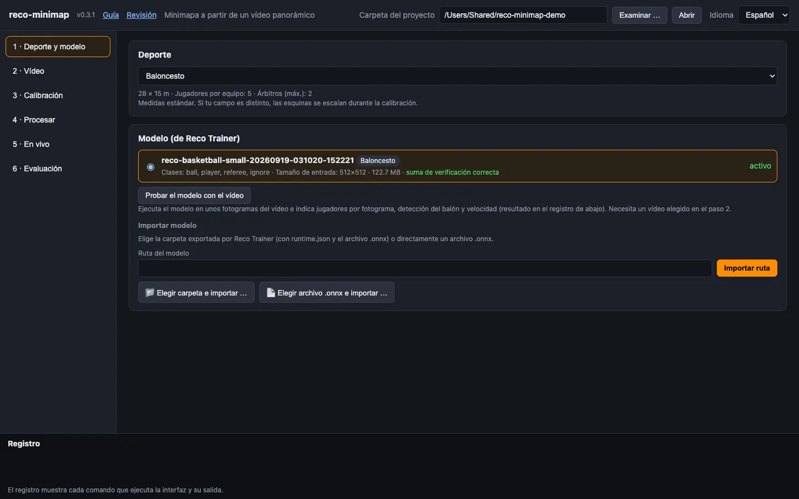
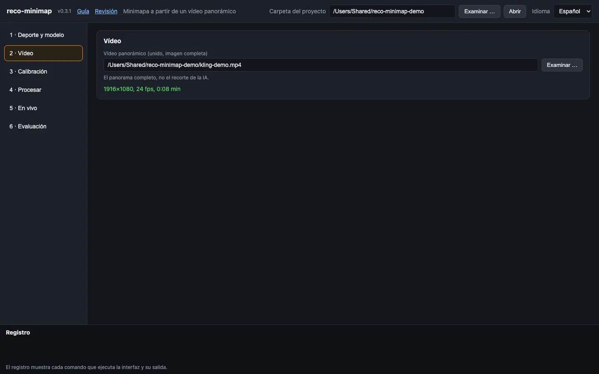
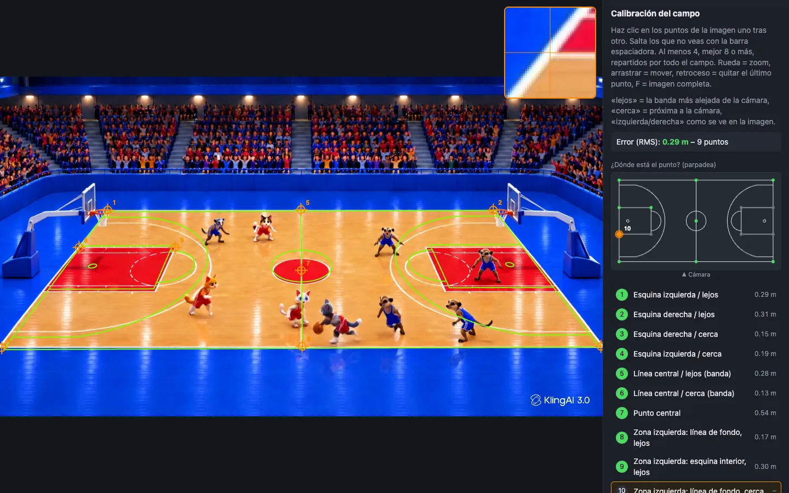
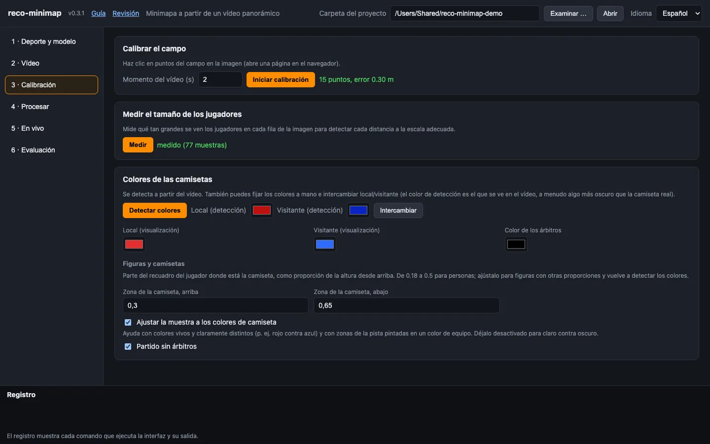
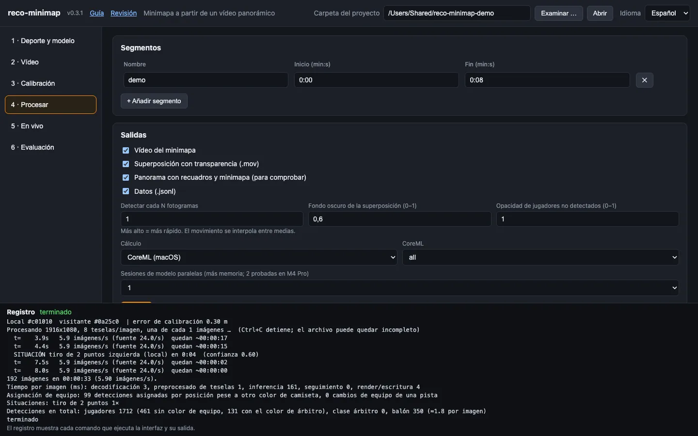
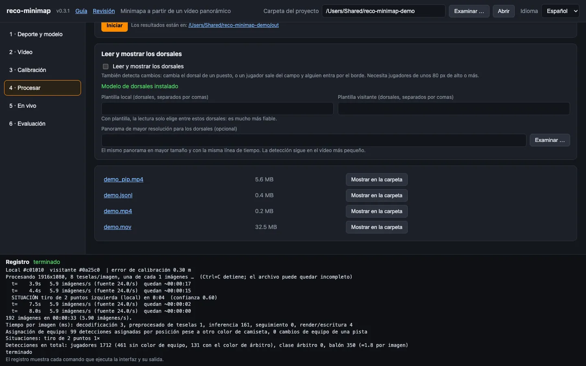
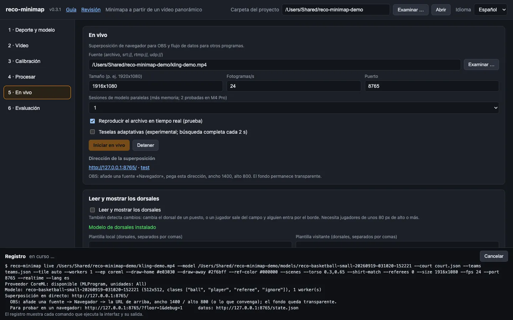
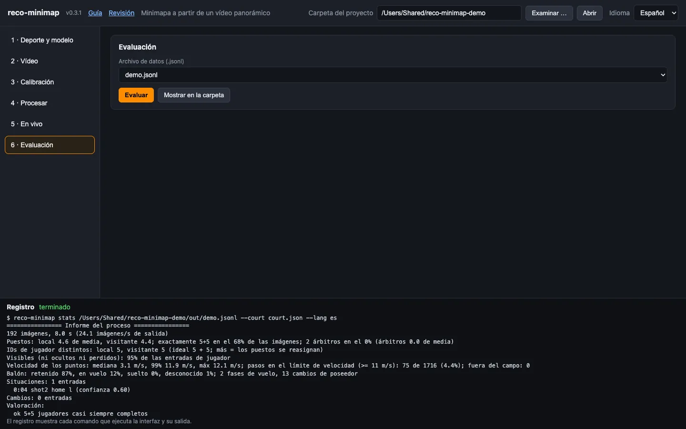

# Guía paso a paso: de dos vídeos de cámara al minimapa

Esta guía te lleva de «tengo un vídeo panorámico y un modelo entrenado» a «tengo un vídeo del minimapa». Sigue los seis pasos de la interfaz. La primera vez necesitarás unos 30 minutos; en los partidos siguientes, unos minutos de clics más el tiempo de cálculo.

<p> </p>

**Así queda el resultado:** los primeros ocho segundos de un vídeo de prueba animado (gatos rojos contra suricatas azules). A la izquierda el vídeo de control con recuadros y el minimapa insertado, a la derecha el minimapa solo. En vídeo: [vídeo de control (MP4)](media/demo-pip.mp4) · [minimapa (MP4)](media/demo-minimap.mp4). Todas las imágenes de esta guía salen de este proyecto de prueba.

**Qué necesitas**

* El programa instalado, ver [Instalación](#instalación) más abajo.
* Un **vídeo panorámico de todo el campo** – la imagen cosida por Reco, **no** el encuadre dirigido por IA. Si solo tienes un vídeo izquierdo y otro derecho, únelos antes con Reco. Para el minimapa basta una exportación a 1920×1080; para los dorsales hace falta una mayor (ver el paso 4).
* Un **modelo de Reco Trainer** (carpeta con `runtime.json`, `model-card.json` y un archivo `.onnx`).
* Opcional: los dorsales de ambas plantillas, si quieres verlos sobre los puntos.

Iniciar la interfaz:

```bash
reco-minimap ui
```

El navegador abre `http://127.0.0.1:8788/`. Arriba a la derecha eliges el idioma (Deutsch · English · Français · Español); los mensajes del programa en el registro siguen esa elección. Arriba está también la **carpeta del proyecto** – ahí se guarda todo lo de un pabellón o una temporada. Por defecto es `~/reco-minimap-projekte/standard`; con *Examinar …* eliges otra.

> Consejo: usa una carpeta de proyecto por pabellón y posición de cámara. La calibración depende de dónde esté la cámara.

## Instalación

| | |
|---|---|
| Rust | cadena de herramientas estable (compilado y probado con la **1.91**) |
| ffmpeg + ffprobe | en tu `PATH` (`brew install ffmpeg`) |
| ONNX Runtime | biblioteca compartida **1.24 o posterior** |
| Un modelo de detección | una exportación RF-DETR en ONNX, p. ej. de Reco Trainer |

**macOS**

```bash
brew install ffmpeg
python3 -m venv ~/ortvenv
~/ortvenv/bin/pip install onnxruntime
find ~/ortvenv -name "libonnxruntime*.dylib"
export ORT_DYLIB_PATH="<la ruta mostrada>"
cargo install --path . --features tools,coreml
```

La biblioteca del paquete de Python incluye CoreML; la de Homebrew no. Añade la línea `export ORT_DYLIB_PATH=…` a `~/.zshrc` para que siga valiendo en ventanas nuevas del terminal.

**Linux**

```bash
sudo apt install ffmpeg
python3 -m venv ~/ortvenv && ~/ortvenv/bin/pip install onnxruntime
export ORT_DYLIB_PATH=$(find ~/ortvenv -name "libonnxruntime.so*" | head -1)
cargo install --path . --features tools
```

Probado en macOS (Apple Silicon); las pruebas se ejecutan en Linux; Windows no está probado.

## Cómo está pensado el uso

El trabajo tiene dos partes: **configurar una vez** y luego **procesar cada partido**.

**Una vez por pabellón y posición de cámara** (pasos 1 a 3)

1. Elegir el deporte e importar el modelo.
2. Elegir un vídeo panorámico de ese pabellón.
3. Calibrar: hacer clic en los puntos del campo, medir el tamaño de los jugadores, fijar los colores de camiseta.

El resultado queda en la carpeta del proyecto (`court.json`, `scales.json`, `teams.json`) y sigue valiendo mientras la cámara esté en el mismo sitio y el panorama se exporte igual. Si cambia alguna de las dos cosas, repite el paso 3.

**En cada partido** (pasos 2, 3c, 4 y 6)

1. Elegir el vídeo nuevo (paso 2).
2. Detectar de nuevo los colores de camiseta, o ponerlos a mano, si juegan otros equipos (paso 3c).
3. Hacer una **prueba corta** de 20 a 60 segundos con el vídeo de comprobación y verla (paso 4).
4. Si está bien, procesar el partido entero por segmentos.
5. Mirar las cifras del paso 6 si algo te resulta raro.

**Qué decide el programa y qué aportas tú**

* Encuentra jugadores, árbitros y balón, los sigue y mantiene un número fijo de puestos por equipo. Un jugador oculto permanece en su posición estimada en vez de desaparecer.
* Tú indicas dónde está el campo, qué colores llevan los equipos y qué tramo de tiempo procesar. Esas tres cosas deciden la calidad; todo lo demás tiene valores por defecto útiles.
* El vídeo de comprobación (*Panorama con recuadros y minimapa*) es tu herramienta de control. Míralo en el primer segmento antes de dejar que se procese un partido entero.

**Al pie de la página** está el registro. Muestra cada comando que ejecuta la interfaz y su salida. Todo lo que hace la interfaz funciona también en la línea de comandos; algunos ajustes finos solo existen allí (`reco-minimap --help`).

**Las versiones nuevas** se anuncian arriba con un aviso azul, ver [Actualizar](#actualizar).

---

## Paso 1 · Deporte y modelo

1. **Elige el deporte.** La lista coincide con Reco Trainer. La línea gris de debajo muestra el tamaño del campo, los jugadores por equipo y los puestos de árbitro. Para un deporte que no esté en la lista, elige la entrada «otro deporte (campo rectangular)» e introduce largo, ancho, número de jugadores y de árbitros.
2. **Importa el modelo.** Usa el botón de importar carpeta y elige la carpeta de Reco Trainer (o el botón de importar un archivo `.onnx` suelto). También puedes escribir una ruta e importarla.
   * El programa comprueba la suma de comprobación de los pesos. Que coincida es el objetivo; un archivo dañado se rechaza.
   * Muestra las clases (`ball, player, referee, ignore`), el tamaño de entrada y el deporte para el que se entrenó el modelo. Si el modelo indica un deporte, se selecciona por ti. Si difiere de tu elección, aparece un aviso rojo.
3. **Comprueba el modelo** (necesita un vídeo del paso 2, así que puedes volver más tarde): el botón de comprobación ejecuta el modelo en unas cuantas imágenes y escribe un informe en el registro. Fíjate en:
   * *Jugadores por imagen (mediana)* cerca del número de jugadores en el campo (10 en baloncesto). Bastante menos significa que el modelo pasa por alto jugadores de ese tamaño – sigue igualmente, el paso 3 lo mejora.
   * El tiempo real por imagen. En un M4 Pro con CoreML son unos cientos de milisegundos.
   * Indica si se cumplen los supuestos sobre la salida del modelo («los recuadros están en 0..1», «la mayoría de las detecciones están en 'player'»).


*Paso 1: deporte elegido, modelo importado, suma de comprobación correcta.*

## Paso 2 · Vídeo

Elige el **vídeo panorámico** (*Examinar …* o pega la ruta). El programa lee tamaño, cadencia y duración y los muestra en verde, p. ej. `1920×1080, 25 imágenes/s, 20:00 min`. Un mensaje rojo significa que el archivo no se pudo leer – comprueba que `ffmpeg` esté instalado.


*Paso 2: el vídeo se ha leído; tamaño, fotogramas por segundo y duración aparecen en verde.*

## Paso 3 · Calibración

La calibración le enseña al programa dónde está el campo en la imagen. Aquí ocurren tres cosas, en este orden.


*El paso 3 de un vistazo: calibración (15 puntos, error 0,30 m), tamaños de jugadores medidos y colores de las camisetas.*

### 3a · Calibrar el campo

1. Pon *Momento del vídeo* en un instante en que **se vea todo el campo** y no lo tapen personas (p. ej. un tiempo muerto o el calentamiento).
2. Haz clic en *Iniciar calibración*. Se abre una página en el navegador con esa imagen.
3. **Haz clic en los puntos en el orden de la lista de la derecha** (esquinas, línea central, centro, esquinas de las zonas …). La lista está en tu idioma.
   * «lejos» y «cerca» designan las dos líneas de banda (lejos = la más alejada de la cámara), «izquierda/derecha» como en la imagen.
   * Sobre la lista, un **pequeño campo visto desde arriba** muestra dónde está el punto que se pide: **parpadea en naranja**. Los puntos ya puestos están en verde, los pendientes en gris. En ese dibujo la cámara está abajo y «lejos» arriba.
   * No tienes que marcarlos todos. Los puntos que no se ven se saltan con la **barra espaciadora**.
   * Rueda del ratón = zoom, arrastrar = mover, **Retroceso** = quitar el último punto, **F** = imagen completa. La ventanita de arriba a la derecha amplía la zona bajo el cursor.
4. A partir del 4.º punto aparece un **campo verde** sobre la imagen y la página muestra el **error en metros**. Añade puntos hasta que las líneas verdes coincidan con las reales. Objetivo: **8 puntos o más, repartidos por todo el campo**, error **inferior a 0,5 m** (verde). Importa más que los puntos estén en sitios distintos que hacer clic con gran precisión.
5. Haz clic en *Guardar*. La interfaz muestra después p. ej. `15 puntos, error 0.21 m`.


*La página de calibración: nueve puntos colocados, las líneas verdes caen sobre el campo. En el pequeño esquema de la derecha parpadea el punto 10, el siguiente; la lupa de arriba muestra la zona bajo el puntero.*

> Un error de 0,00 m tras exactamente cuatro puntos no dice nada – cuatro puntos siempre encajan a la perfección. Juzga por las líneas verdes y usa más puntos.

Si tu pabellón no tiene medidas estándar, marca solo las cuatro esquinas (y el centro); los demás puntos suponen un campo estándar.

### 3b · Medir el tamaño de los jugadores

Haz clic en *Medir*. El programa mira una docena de imágenes y aprende qué tamaño tiene un jugador en cada fila de la imagen. Después, cada franja se analiza con el tamaño de tesela adecuado (`--tile auto`): la detección mejora y es aproximadamente el doble de rápida. Necesita la calibración de 3a. Una vez por posición de cámara.

### 3c · Colores de camiseta

1. Haz clic en *Detectar colores*. El programa recoge los colores de camiseta de los jugadores en el campo y los reparte en dos equipos. En el registro ves los grupos de color encontrados.
2. Ajusta los colores:
   * **Local / Visitante (detección)** – los colores tal como los ve la cámara. Se rellenan solos; con *Intercambiar* cambias local y visitante si están al revés. Si falla («equipos indistinguibles»), elige los dos colores a mano.
   * **Camisetas de portero** (fútbol, futsal, balonmano, hockey, lacrosse) – si los porteros llevan otro color que su equipo, marca *Camisetas de portero*. *Detectar colores* propone los colores de los porteros a partir de las áreas; si no está seguro de qué portero es de qué equipo, lo dice: entonces usa *Intercambiar colores de porteros*. Sin esto, un portero con otra camiseta se confunde con un árbitro o no se detecta. Baloncesto y los deportes sin camiseta de portero no muestran la opción.
   * **Local / Visitante (visualización)** – los colores con los que se dibujan los puntos. Elige lo que quede bien, p. ej. blanco y un azul claro. Un color muy oscuro se ve mal en el minimapa oscuro.
   * **Color de los árbitros** – el color de la camiseta de los árbitros (normalmente negro o amarillo). Así el programa encuentra a los árbitros aunque el modelo no los reconozca.
3. **Figuras y camisetas** (cámbialo solo si hace falta):
   * **Zona de la camiseta, arriba / abajo** – qué parte del recuadro del jugador muestra la camiseta, como proporción de la altura desde arriba. El valor por defecto, de 0,18 a 0,5, va bien para personas. Ajústalo para figuras con otras proporciones (mascotas, animaciones) y vuelve a ejecutar *Detectar colores*.
   * **Ajustar la muestra a los colores de camiseta** – ayuda con colores vivos y claramente distintos (rojo contra azul) y cuando hay zonas del campo pintadas en un color de equipo. Déjalo desactivado para claro contra oscuro: ahí asigna más jugadores al equipo equivocado.
   * **Partido sin árbitros** – así nadie se toma por árbitro por llevar un color de camiseta inusual.


*Colores de camiseta y figuras: para los personajes animados del vídeo de prueba la franja de la camiseta está más abajo (0,3 a 0,65) y la muestra de color se apoya en el rojo y el azul.*

## Paso 4 · Procesar

1. **Segmentos.** Cada fila es un proceso: *Nombre*, *Inicio* y *Fin* como `min:s` (o `h:min:s`, o segundos). Un fin vacío significa hasta el final del vídeo; así puedes analizar solo una parte de una grabación larga. Dividir un partido en cuartos es más seguro – una interrupción cuesta un cuarto, no el partido entero. *Añadir segmento* añade una fila.
2. **Salidas** (marca las casillas):
   * *Vídeo del minimapa* – el minimapa sobre fondo oscuro.
   * *Superposición con transparencia (.mov)* – el minimapa con fondo transparente, para superponerlo en un editor o en OBS. *Fondo oscuro de la superposición* (0–1) añade una superficie oscura semitransparente para que se lea sobre una imagen clara; 0,6 es un buen comienzo.
   * *Panorama con recuadros y minimapa (para comprobar)* – tu panorama con los recuadros de detección y el minimapa en una esquina. Úsalo para **comprobar la calidad** en el primer segmento.
   * *Datos (.jsonl)* – una entrada por imagen con todas las posiciones.
3. **Detectar cada N fotogramas.** 5 es un buen comienzo: la detección se ejecuta en uno de cada 5, el vídeo del minimapa se interpola a la cadencia completa y sigue viéndose fluido. Más alto es más rápido; más bajo, más preciso.
4. **Opacidad de jugadores no detectados.** 1 deja a un jugador oculto totalmente visible en su posición estimada; valores menores lo atenúan.
5. **Cálculo.** *automático* elige CoreML en un Mac. Deja *CoreML* en `all`.
6. Haz clic en **Iniciar**. El registro muestra el progreso y al final un resumen: imágenes procesadas, detecciones, tiempo por etapa. *Cancelar* detiene el proceso.

**¿Dónde están mis archivos?** En `<carpeta del proyecto>/out/`, con el nombre del segmento (`segmento1.mp4`, `segmento1.mov`, `segmento1_pip.mp4`, `segmento1.jsonl`). La lista bajo los ajustes muestra los archivos más recientes con *Mostrar en la carpeta*.

**Haz primero una prueba corta.** Toma un segmento de 20–60 segundos con la casilla *Panorama con recuadros y minimapa* marcada. Abre `…_pip.mp4` y comprueba:

* ¿Están los puntos sobre las personas correctas y en los lugares correctos del campo? Si no, la calibración necesita más puntos o mejor repartidos (paso 3a).
* ¿Hay puntos fantasma o que saltan? Algunos saltos son normales; muchos indican una mala calibración o colores demasiado parecidos.
* ¿Están marcados los árbitros? Si no, revisa el color de los árbitros (paso 3c).

Después procesa el partido entero.


*Paso 4: un segmento (0:00 a 0:08), las cuatro salidas marcadas. El registro de abajo muestra el resumen del proceso.*


*Los archivos terminados bajo el botón Iniciar: el nombre abre el archivo, *Mostrar en la carpeta* lo selecciona en el Finder, la ruta abre la carpeta de resultados.*

### Dorsales (opcional)

En el paso 4 está la sección *Leer y mostrar los dorsales*.

1. Haz clic una vez en *Descargar modelo* (unos 11 MB). El estado cambia a «Modelo de dorsales instalado».
2. Introduce los **dorsales de las plantillas** de ambos equipos, separados por comas (`4,7,10,12,23`). La lectura elige entonces solo entre esos números – mucho más fiable.
3. Marca *Leer y mostrar los dorsales* y ejecuta un segmento.
4. **El tamaño decide.** Un dorsal se lee a partir de unos 10 px de altura de cifra, es decir, jugadores de unos **80 px de alto**. Al final del proceso, el registro indica qué tamaño tienen los jugadores en tu vídeo y si basta. Si no, exporta con Reco una versión mayor del mismo panorama (misma línea de tiempo, misma cadencia) e indícala en *Panorama de mayor resolución para los dorsales*. La detección sigue en el vídeo pequeño.
5. Los dorsales aparecen sobre los puntos cuando están confirmados. Los jugadores cuya espalda nunca se ve se quedan sin número.

**Los cambios** aparecen en el registro (`CAMBIO local en 12:34: #7 -> #12` para un cambio confirmado, «posible cambio» cuando alguien salió del campo por una línea de banda y alguien entró, sin conocerse los dorsales), en `events` del archivo de datos y en el paso 6.

### Situaciones de juego (opcional)

Marca *Detectar situaciones de juego* (en el paso 4, también en el paso 5). El programa reconoce entonces las **formaciones en las interrupciones** y, en baloncesto, los **intentos de tiro**:

* Baloncesto: salto inicial, tiro libre, saque de banda, tiro de 2 y de 3 puntos, cambio.
* Fútbol: saque inicial, penalti, córner, saque de banda, cambio.
* Balonmano: saque de centro, lanzamiento de 7 m, saque de banda, cambio.
* Fútbol sala, hockey, rugby, lacrosse: ver el [catálogo por deporte](SCENARIOS.es.md).

Qué puedes esperar:

* Una situación se anuncia cuando la formación se ha mantenido un momento – p. ej. un jugador en la línea de tiros libres, tres en la zona, todos los demás parados. En el registro aparece entonces p. ej. `SITUACIÓN tiro libre izquierda (local) en 12:34 (confianza 0.85)`.
* **Compruébalo primero con un segmento corto** y compara con el vídeo. Los umbrales son primeras estimaciones; puede anunciarse un saque de banda cuando un jugador simplemente está en la línea, y una situación se pierde si muchos jugadores no se detectan.
* **Los tiros de 2 y 3 puntos** necesitan que el balón se encuentre al soltarlo. Indican el tipo de intento, no si entró. La indicación «cerca de la línea» significa que el error de posición es tan grande como la distancia a la línea de 3 puntos.
* Las escenas figuran en el archivo de datos como eventos con `"type": "scene"` y en el paso 6.

## Paso 5 · En vivo (opcional)

El modo en vivo ofrece una página de superposición transparente para OBS mientras corre el vídeo. Está pensado para retransmisiones; para la edición posterior usa la superposición `.mov` del paso 4.

1. *Fuente*: un archivo o una dirección de flujo (`srt://…`, `rtmp://…`, `udp://…`). Para una primera prueba, elige un archivo de vídeo y marca *Reproducir el archivo en tiempo real*.
2. Introduce *Tamaño* (p. ej. `1920x1080`) y *Fotogramas/s*. Deja el puerto (8765) salvo que esté ocupado.
3. Haz clic en *Iniciar en vivo*. La página muestra la dirección de la superposición, p. ej. `http://127.0.0.1:8765/`.
4. **En OBS:** añade una fuente *Navegador*, pega la dirección, ancho 1400 y alto 800. El fondo queda transparente.
5. Abre la dirección con `?floor=1&debug=1` en un navegador normal para probar sin OBS (suelo oscuro, línea de estado).
6. *Detener* lo termina.

El modo en vivo necesita el mismo panorama completo con el que calibraste, no el encuadre dirigido por IA.


*Paso 5 durante una sesión en directo: *Dirección del overlay* muestra la dirección para OBS y un enlace de prueba.*


*El overlay en directo con `?floor=1` (fondo oscuro para probar); en OBS el fondo es transparente. El anillo naranja marca quién tiene el balón.*

## Paso 6 · Evaluación

Elige un archivo `.jsonl` de `out/` y haz clic en *Evaluar*. El informe del registro responde a esto:

| Línea | Qué es buena señal |
|---|---|
| `exactamente 5+5 en el …% de las imágenes` (baloncesto) | más del 70 % |
| `IDs de jugador distintos: local …, visitante …` | como mucho unos 8 por equipo (más significa que los puestos se reasignan a menudo) |
| `Visibles …%` | más del 85 % |
| `pasos en el límite de velocidad` | menos del 3 % |
| `2 árbitros en el …%` | alto si hay árbitros en el campo |
| `Balón: retenido / en vuelo / suelto / desconocido` | la parte «desconocido» muestra cuántas veces no se encontró el balón; con un modelo de balón débil puede ser alta |
| `Cambios: …` | la lista de cambios con hora y dorsales |
| `Situaciones: …` | cada situación reconocida con hora, equipo y confianza – compara algunas con el vídeo |


*Paso 6: el informe del archivo de datos en el registro.*

---

## Actualizar

Al arrancar, la interfaz pregunta una vez a GitHub si hay una versión más reciente. Solo se envía la consulta: ningún vídeo, imagen ni dato del proyecto.

* Si la hay, aparece arriba un **aviso azul** con el número de versión, un enlace *¿Qué hay de nuevo?* y el botón *Instalar ahora*.
* *Instalar ahora* descarga el código fuente de esa versión y vuelve a compilar el programa. Tarda unos minutos y necesita la misma instalación de Rust con la que instalaste el programa. El registro muestra el progreso.
* Después detén el programa en el terminal con **Ctrl+C** y vuelve a iniciarlo.

En la línea de comandos: `reco-minimap update` indica si hay algo nuevo; `reco-minimap update --yes` lo instala. La comprobación al arrancar se desactiva con `reco-minimap ui --no-update-check`.

## Usar los resultados

**Superponer el minimapa en un vídeo del partido con ffmpeg** (`segmento1.mov` sobre `partido.mp4`, abajo a la derecha, 480 px de ancho):

```bash
ffmpeg -i partido.mp4 -i out/segmento1.mov \
  -filter_complex "[1:v]scale=480:-1[m];[0:v][m]overlay=W-w-30:H-h-30:format=auto" \
  -c:v libx264 -crf 18 -pix_fmt yuv420p -c:a copy partido_con_minimapa.mp4
```

La superposición empieza en el instante de inicio del segmento; usa `-ss` en el vídeo del partido si tu segmento no empezaba en cero. Para partidos enteros en varios segmentos, `scripts/run_game.sh` se encarga del proceso y de la superposición.

**Los datos** (`.jsonl`) sirven para tus propios análisis: un objeto JSON por imagen procesada, con las posiciones en metros en el sistema del campo (`x` a lo largo desde la izquierda, `y` a lo ancho desde la línea de banda del fondo), el estado de cada jugador (`visible`, `occluded`, `lost`), el estado del balón (`held`, `flight`, `loose`, `unknown`) y los eventos.

---

## Si algo no funciona

| Mensaje o síntoma | Qué hacer |
|---|---|
| No se encuentra la biblioteca ONNX Runtime / barra roja arriba | Apunta `ORT_DYLIB_PATH` a `libonnxruntime…dylib` (versión 1.24 o posterior) e inicia `reco-minimap ui` desde el mismo terminal. Ver [Instalación](#instalación). |
| El proveedor CoreML no está incluido | Usa la biblioteca del paquete de Python (`pip install onnxruntime`), no la de Homebrew – o pon *Cálculo* en `CPU`. |
| No se encuentra ffmpeg | `brew install ffmpeg` |
| *Examinar …* no hace nada | Los diálogos de archivo necesitan macOS (o `zenity` en Linux). Pega la ruta en su lugar. |
| `zsh: command not found: #…` | No pegues en el terminal líneas que empiecen por `#` – zsh no las trata como comentarios. |
| *Detectar colores* falla | Revisa la calibración (solo cuentan los jugadores dentro del campo calibrado) y pon los colores a mano. |
| Pocos jugadores detectados | Ejecuta *Medir* (3b). El programa ya sigue a un jugador con detecciones inseguras (desde 0,30) pero solo crea un punto con una segura (desde 0,60); si el modelo es inseguro en todo tu material, baja `--thr-player` en la línea de comandos (p. ej. 0,5). Una imagen pequeña o borrosa limita al modelo. |
| Colores de equipo erróneos, o puntos del color equivocado | Pon los colores a mano en 3c. Con colores vivos o zonas de campo coloreadas, activa *Ajustar la muestra a los colores de camiseta*. |
| Dos «árbitros» aunque no hay ninguno | Activa *Partido sin árbitros* en 3c. |
| Puntos en el lugar equivocado | Vuelve a calibrar con más puntos por todo el campo; el campo verde debe coincidir con las líneas reales. |
| Faltan los árbitros | Ajusta el color de la camiseta de los árbitros (3c). |
| Muy lento | *Detectar cada N fotogramas* con un N mayor; *Cálculo* en CoreML; ejecuta *Medir* para necesitar menos teselas. |
| Los dorsales se quedan vacíos | ¿Está instalado el modelo de dorsales? ¿Son los jugadores lo bastante grandes (resumen al final del proceso)? ¿Has introducido las plantillas? |
| Puerto ocupado | Inicia con `reco-minimap ui --port 8800`. |

¿Atascado? Mira el registro (al pie de la página): muestra el comando exacto (`$ reco-minimap …`). Puedes copiarlo en un terminal y obtener la misma salida con más detalle.
