# Guide pas à pas : de deux vidéos de caméra à la minimap

Ce guide vous mène de « j'ai une vidéo panoramique et un modèle entraîné » à « j'ai une vidéo de minimap ». Il suit les six étapes de l'interface. La première fois, comptez environ 30 minutes ; pour les matchs suivants, quelques minutes de clics plus le temps de calcul.

<p>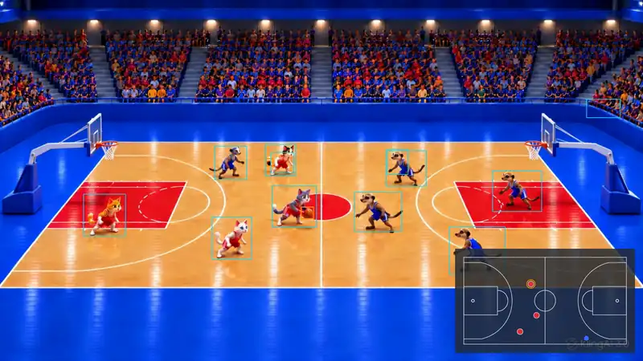 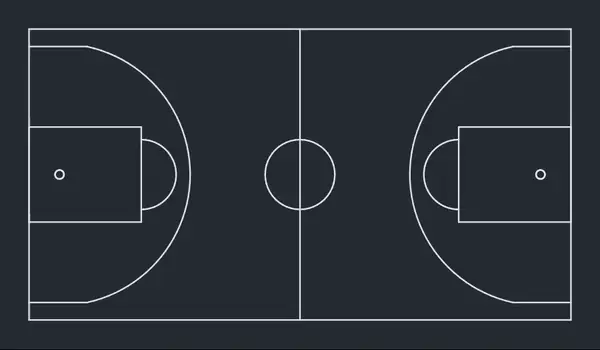</p>

**Voici le résultat :** les huit premières secondes d'une vidéo de test animée (chats rouges contre suricates bleus). À gauche la vidéo de contrôle avec cadres et minimap incrustée, à droite la minimap seule. En vidéo : [vidéo de contrôle (MP4)](media/demo-pip.mp4) · [minimap (MP4)](media/demo-minimap.mp4). Toutes les images de ce guide viennent de ce projet de test.

**Ce qu'il vous faut**

* Le programme installé, voir [Installation](#installation) ci-dessous.
* Une **vidéo panoramique de tout le terrain** – l'image assemblée par Reco, **pas** le cadrage piloté par l'IA. Si vous n'avez qu'une vidéo gauche et une vidéo droite, assemblez-les d'abord avec Reco. Un export en 1920×1080 suffit pour la minimap ; pour les numéros de maillot il en faut un plus grand (voir l'étape 4).
* Un **modèle issu de Reco Trainer** (dossier contenant `runtime.json`, `model-card.json` et un fichier `.onnx`).
* Facultatif : les numéros des deux effectifs, si vous voulez les afficher sur les points.

Lancer l'interface :

```bash
reco-minimap ui
```

Le navigateur ouvre `http://127.0.0.1:8788/`. En haut à droite, choisissez la langue (Deutsch · English · Français · Español) ; les messages du programme dans le journal suivent ce choix. En haut se trouve aussi le **dossier du projet** – tout ce qui concerne une salle ou une saison y est rangé. Par défaut `~/reco-minimap-projekte/standard` ; *Parcourir …* permet d'en choisir un autre.

> Conseil : utilisez un dossier de projet par salle et par position de caméra. Le calibrage dépend de l'emplacement de la caméra.

## Installation

| | |
|---|---|
| Rust | chaîne d'outils stable (compilé et testé avec la **1.91**) |
| ffmpeg + ffprobe | dans votre `PATH` (`brew install ffmpeg`) |
| ONNX Runtime | bibliothèque partagée **1.24 ou plus récente** |
| Un modèle de détection | un export RF-DETR au format ONNX, p. ex. depuis Reco Trainer |

**macOS**

```bash
brew install ffmpeg
python3 -m venv ~/ortvenv
~/ortvenv/bin/pip install onnxruntime
find ~/ortvenv -name "libonnxruntime*.dylib"
export ORT_DYLIB_PATH="<le chemin affiché>"
cargo install --path . --features tools,coreml
```

La bibliothèque du paquet Python contient CoreML ; celle de Homebrew non. Ajoutez la ligne `export ORT_DYLIB_PATH=…` à `~/.zshrc` pour qu'elle reste valable dans les nouvelles fenêtres de terminal.

**Linux**

```bash
sudo apt install ffmpeg
python3 -m venv ~/ortvenv && ~/ortvenv/bin/pip install onnxruntime
export ORT_DYLIB_PATH=$(find ~/ortvenv -name "libonnxruntime.so*" | head -1)
cargo install --path . --features tools
```

Testé sur macOS (Apple Silicon) ; la suite de tests tourne sous Linux ; Windows n'est pas testé.

## Comment l'outil est pensé

Le travail se fait en deux temps : **régler une fois**, puis **traiter chaque match**.

**Une fois par salle et par position de caméra** (étapes 1 à 3)

1. Choisir le sport et importer le modèle.
2. Choisir une vidéo panoramique de cette salle.
3. Calibrer : cliquer les repères du terrain, mesurer la taille des joueurs, fixer les couleurs de maillot.

Le résultat se trouve dans le dossier du projet (`court.json`, `scales.json`, `teams.json`) et reste valable tant que la caméra est au même endroit et que le panorama est exporté de la même façon. Si l'un des deux change, refaites l'étape 3.

**Pour chaque match** (étapes 2, 3c, 4 et 6)

1. Choisir la nouvelle vidéo (étape 2).
2. Détecter à nouveau les couleurs de maillot, ou les régler à la main, si d'autres équipes jouent (étape 3c).
3. Faire un **court essai** de 20 à 60 secondes avec la vidéo de contrôle et le regarder (étape 4).
4. Si tout va bien, traiter le match entier par segments.
5. Regarder les chiffres de l'étape 6 si quelque chose vous paraît étrange.

**Ce que le programme décide et ce que vous fournissez**

* Il trouve les joueurs, les arbitres et le ballon, les suit et garde un nombre fixe de places par équipe. Un joueur masqué reste à sa position estimée au lieu de disparaître.
* Vous indiquez où se trouve le terrain, quelles couleurs portent les équipes et quelle plage de temps traiter. Ces trois indications déterminent la qualité ; tout le reste a des valeurs par défaut utilisables.
* La vidéo de contrôle (*Panorama avec cadres et minimap*) est votre outil de vérification. Regardez-la pour le premier segment avant de lancer un match entier.

**En bas de la page** se trouve le journal. Il affiche chaque commande lancée par l'interface et sa sortie. Tout ce que fait l'interface fonctionne aussi en ligne de commande ; quelques réglages fins n'existent que là (`reco-minimap --help`).

**Les nouvelles versions** sont signalées en haut par un bandeau bleu, voir [Mise à jour](#mise-à-jour).

---

## Étape 1 · Sport et modèle

1. **Choisir le sport.** La liste correspond à Reco Trainer. La ligne grise en dessous indique la taille du terrain, le nombre de joueurs par équipe et les places d'arbitre. Pour un sport absent de la liste, choisissez l'entrée « autre sport (terrain rectangulaire) » et saisissez longueur, largeur, nombre de joueurs et d'arbitres.
2. **Importer le modèle.** Utilisez le bouton d'import de dossier et choisissez le dossier issu de Reco Trainer (ou le bouton d'import d'un fichier `.onnx` seul). Vous pouvez aussi saisir un chemin et l'importer.
   * Le programme vérifie la somme de contrôle des poids. Une somme correcte est l'objectif ; un fichier endommagé est refusé.
   * Il affiche les classes (`ball, player, referee, ignore`), la taille d'entrée et le sport pour lequel le modèle a été entraîné. Si le modèle indique un sport, celui-ci est sélectionné pour vous. S'il diffère de votre choix, un avertissement rouge apparaît.
3. **Vérifier le modèle** (nécessite une vidéo de l'étape 2, vous pouvez donc y revenir plus tard) : le bouton de vérification fait tourner le modèle sur quelques images et écrit un rapport dans le journal. À surveiller :
   * *Joueurs par image (médiane)* proche du nombre de joueurs sur le terrain (10 au basketball). Nettement moins signifie que le modèle manque des joueurs à cette taille – continuez quand même, l'étape 3 améliore cela.
   * Le temps réel par image. Sur un M4 Pro avec CoreML, quelques centaines de millisecondes.
   * Il indique si les hypothèses sur la sortie du modèle sont vérifiées (« les boîtes sont dans 0..1 », « la plupart des détections sont sur 'player' »).

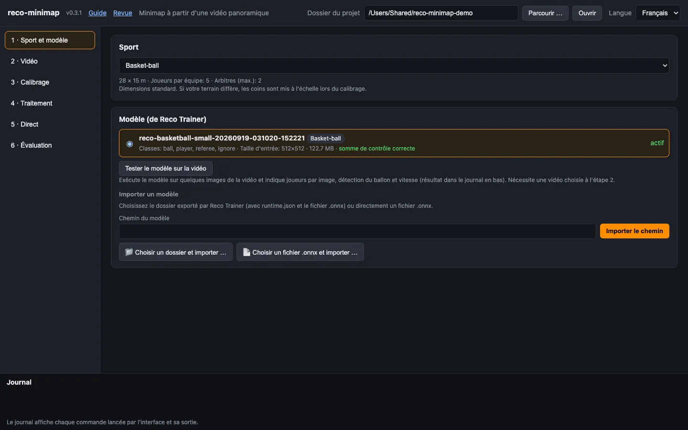
*Étape 1 : sport choisi, modèle importé, somme de contrôle correcte.*

## Étape 2 · Vidéo

Choisissez la **vidéo panoramique** (*Parcourir …* ou collez le chemin). Le programme lit la taille, la cadence et la durée et les affiche en vert, p. ex. `1920×1080, 25 images/s, 20:00 min`. Un message rouge signifie que le fichier est illisible – vérifiez que `ffmpeg` est installé.

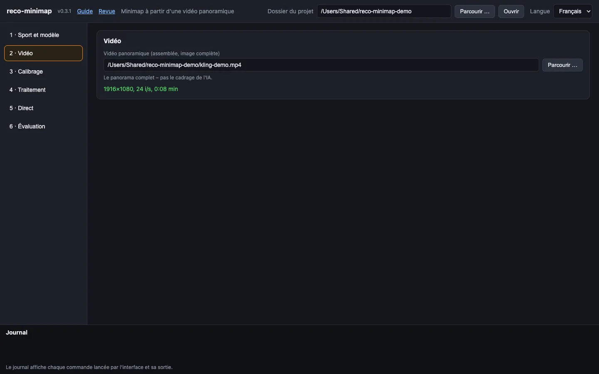
*Étape 2 : la vidéo est lue – taille, cadence et durée s'affichent en vert.*

## Étape 3 · Calibrage

Le calibrage apprend au programme où se trouve le terrain dans l'image. Trois choses se passent ici, dans cet ordre.

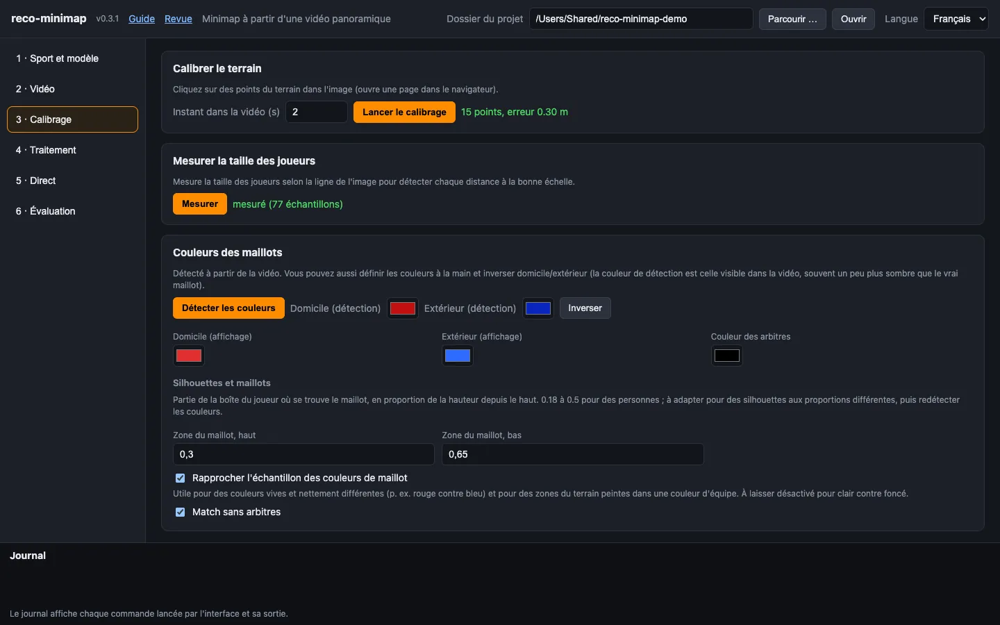
*L'étape 3 en un coup d'œil : calibrage (15 points, erreur 0,30 m), tailles de joueurs mesurées et couleurs des maillots.*

### 3a · Calibrer le terrain

1. Réglez *Instant dans la vidéo* sur un moment où **tout le terrain est visible** et non masqué par des personnes (p. ex. un temps mort ou l'échauffement).
2. Cliquez *Lancer le calibrage*. Une page s'ouvre dans le navigateur avec cette image.
3. **Cliquez les points dans l'ordre de la liste à droite** (coins, ligne médiane, centre, coins des zones …). La liste est dans votre langue.
   * « loin » et « proche » désignent les deux lignes de touche (loin = la plus éloignée de la caméra), « gauche/droite » comme dans l'image.
   * Au-dessus de la liste, un **petit terrain vu de dessus** montre où se trouve le point demandé : il **clignote en orange**. Les points déjà placés sont verts, les autres gris. Dans ce dessin, la caméra est en bas et « loin » en haut.
   * Vous n'êtes pas obligé de tout cliquer. Les points invisibles se passent avec la **barre d'espace**.
   * Molette = zoom, glisser = déplacer, **Retour arrière** = retirer le dernier point, **F** = image entière. La petite fenêtre en haut à droite agrandit la zone sous le pointeur.
4. À partir du 4ᵉ point, un **terrain vert** apparaît sur l'image et la page indique l'**erreur en mètres**. Ajoutez des points jusqu'à ce que les lignes vertes se superposent aux vraies lignes. Objectif : **8 points ou plus, répartis sur tout le terrain**, erreur **inférieure à 0,5 m** (vert). Des points à des endroits différents comptent plus qu'un clic très précis.
5. Cliquez *Enregistrer*. L'interface affiche ensuite p. ex. `15 points, erreur 0.21 m`.

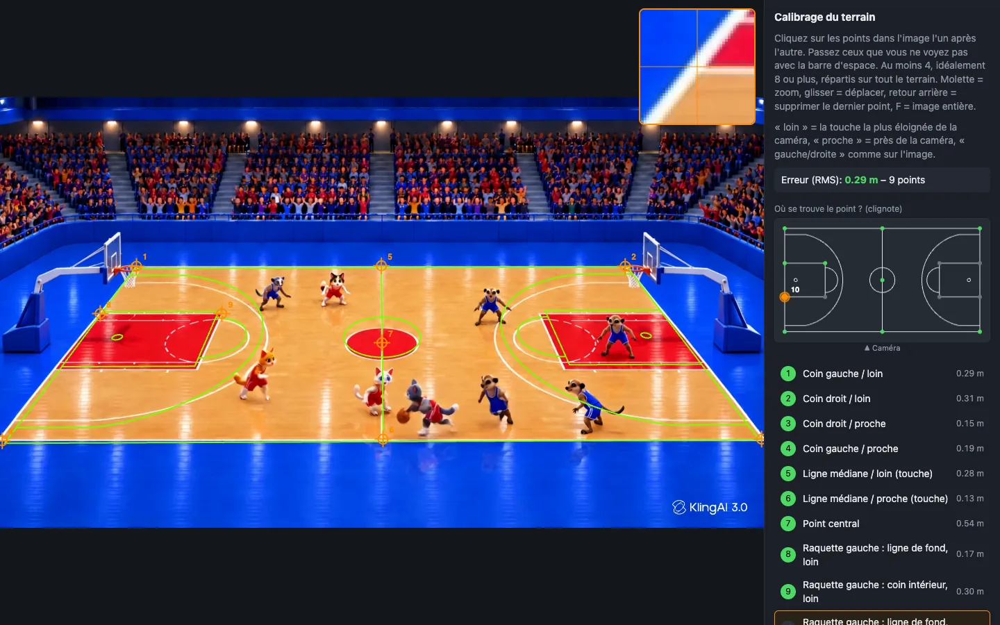
*La page de calibrage : neuf points placés, les lignes vertes tombent sur le terrain. Dans le petit schéma à droite, le point 10 – le suivant – clignote ; la loupe en haut montre l'endroit sous le pointeur.*

> Une erreur de 0,00 m après exactement quatre points ne veut rien dire – quatre points s'ajustent toujours parfaitement. Jugez d'après les lignes vertes et ajoutez des points.

Si votre salle n'a pas les dimensions standard, ne cliquez que les quatre coins (et le centre) ; les autres points supposent un terrain standard.

### 3b · Mesurer la taille des joueurs

Cliquez *Mesurer*. Le programme examine une douzaine d'images et apprend quelle taille a un joueur à chaque ligne de l'image. Ensuite, chaque bande de l'image est analysée avec la taille de tuile adaptée (`--tile auto`) : la détection s'améliore et devient environ deux fois plus rapide. Cela nécessite le calibrage de 3a. Une fois par position de caméra.

### 3c · Couleurs de maillot

1. Cliquez *Détecter les couleurs*. Le programme relève les couleurs de maillot des joueurs sur le terrain et les répartit en deux équipes. Le journal montre les groupes de couleurs trouvés.
2. Réglez les couleurs :
   * **Domicile / Extérieur (détection)** – les couleurs telles que la caméra les voit. Elles sont renseignées automatiquement ; *Inverser* échange domicile et extérieur si besoin. En cas d'échec (« équipes indiscernables »), choisissez les deux couleurs à la main.
   * **Domicile / Extérieur (affichage)** – les couleurs dans lesquelles les points sont dessinés. Prenez ce qui rend bien, p. ex. du blanc et un bleu clair. Une couleur très sombre se voit mal sur la minimap sombre.
   * **Couleur des arbitres** – la couleur du maillot des arbitres (souvent noir ou jaune). Le programme trouve ainsi les arbitres même si le modèle ne les reconnaît pas.
3. **Silhouettes et maillots** (à ne modifier qu'en cas de besoin) :
   * **Zone du maillot, haut / bas** – quelle partie de la boîte du joueur montre le maillot, en proportion de la hauteur depuis le haut. La valeur par défaut, 0,18 à 0,5, convient pour des personnes. Adaptez-la pour des silhouettes aux proportions différentes (mascottes, animations), puis relancez *Détecter les couleurs*.
   * **Rapprocher l'échantillon des couleurs de maillot** – utile pour des couleurs vives et nettement différentes (rouge contre bleu) et lorsque des zones du terrain sont peintes dans une couleur d'équipe. À laisser désactivé pour clair contre foncé : dans ce cas, davantage de joueurs sont mal attribués.
   * **Match sans arbitres** – personne n'est alors pris pour un arbitre à cause d'une couleur de maillot inhabituelle.

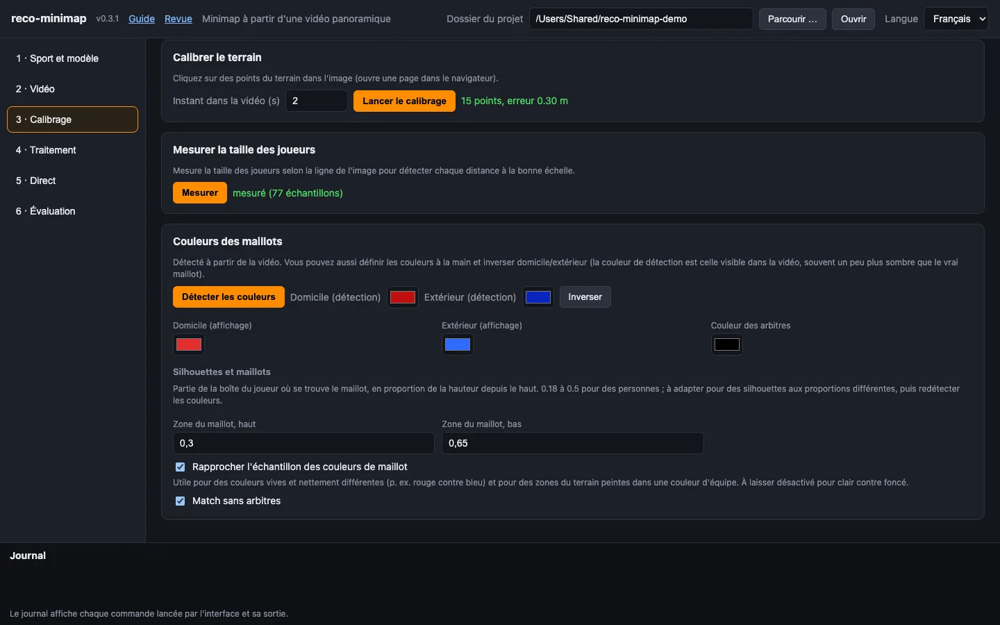
*Couleurs des maillots et silhouettes : pour les personnages animés de la vidéo de test, la zone du maillot est plus basse (0,3 à 0,65) et l'échantillon de couleur s'appuie sur le rouge et le bleu.*

## Étape 4 · Traitement

1. **Segments.** Chaque ligne est un traitement : *Nom*, *Début* et *Fin* sous la forme `min:s` (ou `h:min:s`, ou des secondes). Une fin vide signifie jusqu'à la fin de la vidéo ; vous pouvez ainsi n'analyser qu'une partie d'un long enregistrement. Découper un match en quart-temps est plus sûr – une interruption coûte un quart-temps, pas le match entier. *Ajouter un segment* ajoute une ligne.
2. **Sorties** (cochez) :
   * *Vidéo de la minimap* – la minimap sur fond sombre.
   * *Overlay avec transparence (.mov)* – la minimap sur fond transparent, à incruster dans un logiciel de montage ou OBS. *Fond sombre de l'overlay* (0–1) ajoute une surface sombre semi-transparente pour qu'elle reste lisible sur une image claire ; 0,6 est un bon début.
   * *Panorama avec cadres et minimap (contrôle)* – votre panorama avec les boîtes de détection et la minimap dans un coin. Utilisez-le pour **vérifier la qualité** sur le premier segment.
   * *Données (.jsonl)* – une entrée par image avec toutes les positions.
3. **Détecter toutes les N images.** 5 est un bon début : la détection tourne une image sur 5, la vidéo de la minimap est interpolée à la cadence complète et reste fluide. Plus grand, c'est plus rapide ; plus petit, plus précis.
4. **Opacité des joueurs non détectés.** 1 laisse un joueur masqué entièrement visible à sa position estimée ; des valeurs plus faibles l'estompent.
5. **Calcul.** *automatique* choisit CoreML sur un Mac. Laissez *CoreML* sur `all`.
6. Cliquez **Démarrer**. Le journal montre la progression puis un récapitulatif : images traitées, détections, temps par étape. *Annuler* arrête le traitement.

**Où sont mes fichiers ?** Dans `<dossier du projet>/out/`, nommés d'après le segment (`segment1.mp4`, `segment1.mov`, `segment1_pip.mp4`, `segment1.jsonl`). La liste sous les réglages montre les fichiers les plus récents avec *Afficher dans le dossier*.

**Commencez par un court essai.** Prenez un segment de 20 à 60 secondes avec la case *Panorama avec cadres et minimap* cochée. Ouvrez `…_pip.mp4` et vérifiez :

* Les points sont-ils sur les bonnes personnes et aux bons endroits du terrain ? Sinon, le calibrage a besoin de points plus nombreux ou mieux répartis (étape 3a).
* Y a-t-il des points fantômes ou qui sautent ? Quelques sauts sont normaux ; beaucoup indiquent un mauvais calibrage ou des couleurs trop proches.
* Les arbitres sont-ils marqués ? Sinon, vérifiez la couleur des arbitres (étape 3c).

Traitez ensuite le match entier.

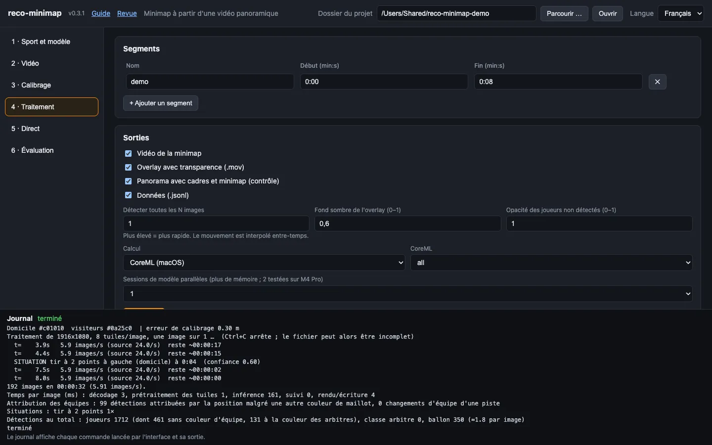
*Étape 4 : un segment (0:00 à 0:08), les quatre sorties cochées. Le journal en bas montre le résumé du traitement.*

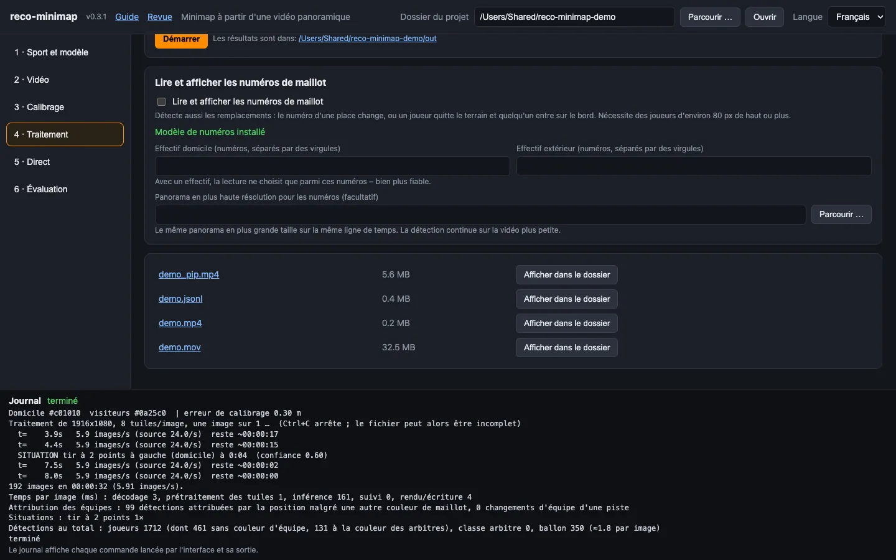
*Les fichiers terminés sous le bouton Démarrer : le nom ouvre le fichier, *Afficher dans le dossier* le sélectionne dans le Finder, le chemin ouvre le dossier des résultats.*

### Numéros de maillot (facultatif)

À l'étape 4 se trouve la section *Lire et afficher les numéros de maillot*.

1. Cliquez une fois *Télécharger le modèle* (environ 11 Mo). L'état passe à « Modèle de numéros installé ».
2. Saisissez les **numéros des effectifs** des deux équipes, séparés par des virgules (`4,7,10,12,23`). La lecture ne choisit alors que parmi ces numéros – bien plus fiable.
3. Cochez *Lire et afficher les numéros de maillot* et lancez un segment.
4. **La taille décide.** Un numéro est lisible à partir d'environ 10 px de hauteur de chiffre, soit des joueurs d'environ **80 px de haut**. À la fin du traitement, le journal indique la taille des joueurs dans votre vidéo et si cela suffit. Sinon, exportez avec Reco une version plus grande du même panorama (même ligne de temps, même cadence) et indiquez-la dans *Panorama en plus haute résolution pour les numéros*. La détection continue sur la petite vidéo.
5. Les numéros apparaissent sur les points une fois confirmés. Les joueurs dont le dos n'est jamais visible restent sans numéro.

**Les changements** apparaissent dans le journal (`CHANGEMENT domicile à 12:34 : #7 -> #12` pour un changement confirmé, « changement possible » lorsqu'un joueur a quitté le terrain par une ligne de touche et que quelqu'un est entré, sans que les numéros soient connus), dans `events` du fichier de données et à l'étape 6.

### Situations de jeu (facultatif)

Cochez *Détecter les situations de jeu* (à l'étape 4, présent aussi à l'étape 5). Le programme reconnaît alors les **placements lors des arrêts de jeu** et, au basketball, les **tentatives de tir** :

* Basketball : entre-deux, lancer franc, remise en jeu, tir à 2 et à 3 points, changement.
* Football : coup d'envoi, penalty, corner, touche, changement.
* Handball : engagement, jet de 7 m, touche, changement.
* Futsal, hockey, rugby, crosse : voir le [catalogue par sport](SCENARIOS.fr.md).

À quoi s'attendre :

* Une situation est signalée lorsque le placement a tenu un instant – p. ex. un joueur sur la ligne de lancer franc, trois dans la raquette, tous les autres immobiles. Le journal affiche alors p. ex. `SITUATION lancer franc à gauche (domicile) à 12:34 (confiance 0.85)`.
* **Vérifiez d'abord sur un court segment** en comparant avec la vidéo. Les seuils sont de premières estimations ; une touche peut être signalée lorsqu'un joueur se tient simplement sur la ligne, et une situation est manquée si beaucoup de joueurs ne sont pas détectés.
* **Les tirs à 2 et 3 points** nécessitent que le ballon soit trouvé au moment du lâcher. Ils indiquent le type de tentative, pas si elle a réussi. La mention « près de la ligne » signifie que l'erreur de position est du même ordre que la distance à la ligne à 3 points.
* Les scènes figurent dans le fichier de données comme événements avec `"type": "scene"` et à l'étape 6.

## Étape 5 · Direct (facultatif)

Le mode direct fournit une page d'incrustation transparente pour OBS pendant que la vidéo défile. Il est destiné aux diffusions ; pour le montage, utilisez l'overlay `.mov` de l'étape 4.

1. *Source* : un fichier ou une adresse de flux (`srt://…`, `rtmp://…`, `udp://…`). Pour un premier test, choisissez un fichier vidéo et cochez *Lire le fichier en temps réel*.
2. Saisissez *Taille* (p. ex. `1920x1080`) et *Images/s*. Laissez le port (8765), sauf s'il est occupé.
3. Cliquez *Démarrer le direct*. La page affiche l'adresse de l'incrustation, p. ex. `http://127.0.0.1:8765/`.
4. **Dans OBS :** ajoutez une source *Navigateur*, collez l'adresse, largeur 1400 et hauteur 800. Le fond reste transparent.
5. Ouvrez l'adresse avec `?floor=1&debug=1` dans un navigateur ordinaire pour tester sans OBS (sol sombre, ligne d'état).
6. *Arrêter* y met fin.

Le mode direct nécessite le même panorama complet que celui du calibrage, pas le cadrage piloté par l'IA.

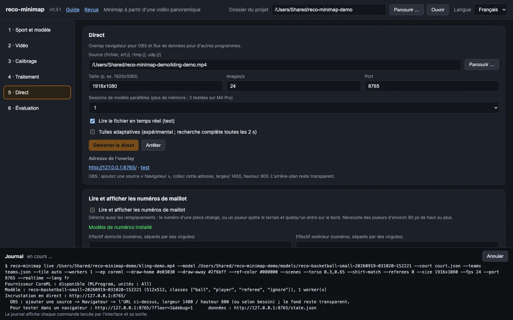
*Étape 5 pendant un direct : *Adresse de l'overlay* donne l'adresse pour OBS et un lien de test.*

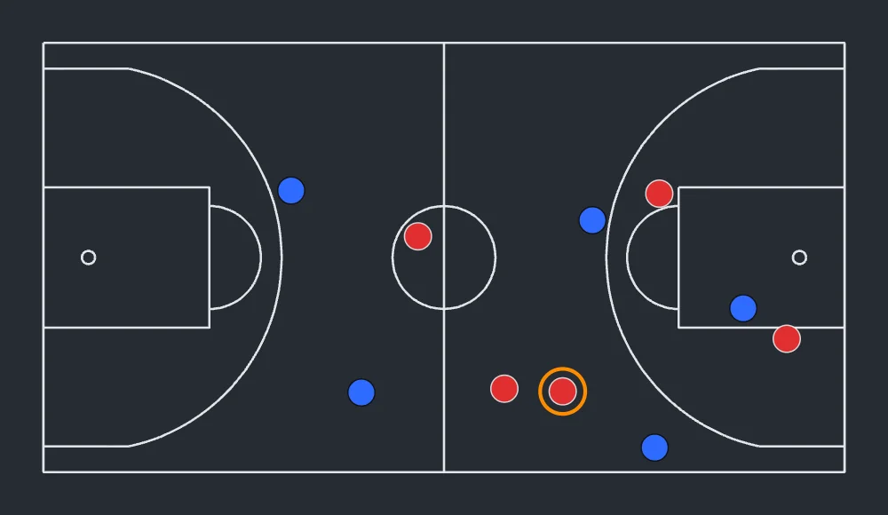
*L'overlay en direct avec `?floor=1` (fond sombre pour tester) ; dans OBS le fond est transparent. L'anneau orange indique qui a le ballon.*

## Étape 6 · Évaluation

Choisissez un fichier `.jsonl` dans `out/` et cliquez *Évaluer*. Le rapport dans le journal répond à ceci :

| Ligne | Ce qui est bon signe |
|---|---|
| `exactement 5+5 dans …% des images` (basketball) | plus de 70 % |
| `Identifiants de joueurs distincts : domicile …, visiteurs …` | au plus environ 8 par équipe (davantage : les places sont souvent réattribuées) |
| `Visibles …%` | plus de 85 % |
| `pas à la vitesse limite` | moins de 3 % |
| `2 arbitres dans …%` | élevé si des arbitres sont sur le terrain |
| `Ballon : tenu / en vol / libre / inconnu` | la part « inconnu » indique combien de fois le ballon n'a pas été trouvé ; avec un modèle de ballon faible, elle peut être élevée |
| `Changements : …` | la liste des changements avec l'heure et les numéros |
| `Situations : …` | chaque situation reconnue avec l'heure, l'équipe et la confiance – comparez-en quelques-unes avec la vidéo |

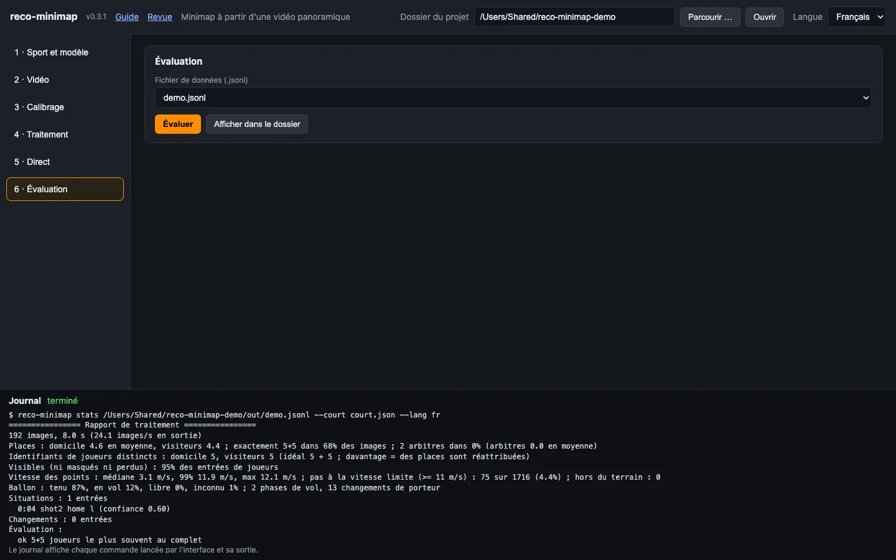
*Étape 6 : le rapport sur le fichier de données dans le journal.*

---

## Mise à jour

Au démarrage, l'interface demande une fois à GitHub s'il existe une version plus récente. Seule la requête est envoyée : aucune vidéo, image ni donnée de projet.

* S'il y en a une, un **bandeau bleu** apparaît en haut avec le numéro de version, un lien *Quoi de neuf ?* et le bouton *Installer maintenant*.
* *Installer maintenant* récupère les sources de cette version et recompile le programme. Cela prend quelques minutes et nécessite la même installation de Rust que celle utilisée pour installer le programme. Le journal montre la progression.
* Arrêtez ensuite le programme dans le terminal avec **Ctrl+C** et relancez-le.

En ligne de commande : `reco-minimap update` indique s'il y a du nouveau ; `reco-minimap update --yes` l'installe. La vérification au démarrage se désactive avec `reco-minimap ui --no-update-check`.

## Utiliser les résultats

**Incruster la minimap dans une vidéo de match avec ffmpeg** (`segment1.mov` sur `match.mp4`, en bas à droite, 480 px de large) :

```bash
ffmpeg -i match.mp4 -i out/segment1.mov \
  -filter_complex "[1:v]scale=480:-1[m];[0:v][m]overlay=W-w-30:H-h-30:format=auto" \
  -c:v libx264 -crf 18 -pix_fmt yuv420p -c:a copy match_avec_minimap.mp4
```

L'overlay commence à l'instant de début du segment ; utilisez `-ss` sur la vidéo du match si votre segment ne commençait pas à zéro. Pour des matchs entiers en plusieurs segments, `scripts/run_game.sh` se charge du traitement et de l'incrustation.

**Les données** (`.jsonl`) servent à vos propres analyses : un objet JSON par image traitée, avec les positions en mètres dans le repère du terrain (`x` le long de la longueur depuis la gauche, `y` le long de la largeur depuis la ligne de touche du fond), l'état de chaque joueur (`visible`, `occluded`, `lost`), l'état du ballon (`held`, `flight`, `loose`, `unknown`) et les événements.

---

## En cas de problème

| Message ou symptôme | Que faire |
|---|---|
| Bibliothèque ONNX Runtime introuvable / bandeau rouge en haut | Faire pointer `ORT_DYLIB_PATH` sur `libonnxruntime…dylib` (version 1.24 ou plus récente) et lancer `reco-minimap ui` depuis le même terminal. Voir [Installation](#installation). |
| Le fournisseur CoreML n'est pas inclus | Prendre la bibliothèque du paquet Python (`pip install onnxruntime`), pas celle de Homebrew – ou régler *Calcul* sur `CPU`. |
| ffmpeg introuvable | `brew install ffmpeg` |
| *Parcourir …* ne fait rien | Les boîtes de dialogue de fichiers nécessitent macOS (ou `zenity` sous Linux). Collez le chemin à la place. |
| `zsh: command not found: #…` | Ne collez pas dans le terminal les lignes commençant par `#` – zsh ne les traite pas comme des commentaires. |
| *Détecter les couleurs* échoue | Vérifier le calibrage (seuls les joueurs dans le terrain calibré comptent) et régler les couleurs à la main. |
| Peu de joueurs détectés | Lancer *Mesurer* (3b). Le programme suit déjà un joueur avec des détections incertaines (à partir de 0,30) mais ne crée un point que sur une détection sûre (à partir de 0,60) ; si le modèle est incertain partout sur vos images, baissez `--thr-player` en ligne de commande (p. ex. 0,5). Une image petite ou floue limite le modèle. |
| Couleurs d'équipe fausses, ou points de la mauvaise couleur | Régler les couleurs à la main en 3c. Pour des couleurs vives ou des zones de terrain colorées, activer *Rapprocher l'échantillon des couleurs de maillot*. |
| Deux « arbitres » alors qu'il n'y en a pas | Activer *Match sans arbitres* en 3c. |
| Points au mauvais endroit | Recalibrer avec plus de points sur tout le terrain ; le terrain vert doit se superposer aux vraies lignes. |
| Arbitres absents | Régler la couleur du maillot des arbitres (3c). |
| Très lent | *Détecter toutes les N images* avec un N plus grand ; *Calcul* sur CoreML ; lancer *Mesurer* pour réduire le nombre de tuiles. |
| Les numéros restent vides | Le modèle de numéros est-il installé ? Les joueurs sont-ils assez grands (récapitulatif en fin de traitement) ? Avez-vous saisi les effectifs ? |
| Port occupé | Lancer avec `reco-minimap ui --port 8800`. |

Bloqué ? Regardez le journal (en bas de la page) : il montre la commande exacte (`$ reco-minimap …`). Vous pouvez la copier dans un terminal et obtenir la même sortie avec plus de détails.
