# Walkthrough: from two camera videos to a minimap

This guide takes you from "I have a panorama video" to "I have a minimap video". It follows the seven steps of the interface. Allow about 30 minutes the first time; later games take a few minutes of clicking plus processing time.

<p>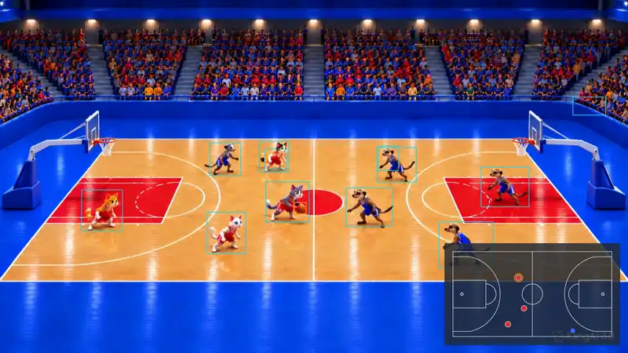 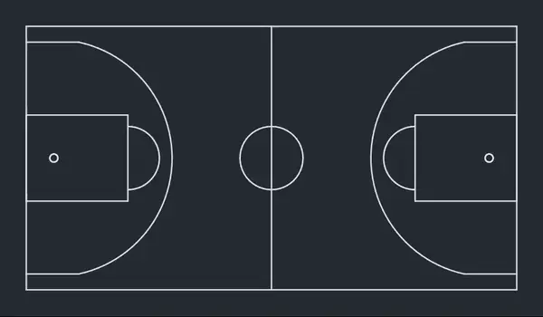</p>

**This is what you get:** the first eight seconds of an animated test video (red cats against blue meerkats). Left the check video with boxes and the minimap inset, right the minimap on its own. As video: [check video (MP4)](media/demo-pip.mp4) · [minimap (MP4)](media/demo-minimap.mp4). All pictures in this guide come from this test project.

**What you need before you start**

* The reco-minimap program installed, see [Installation](#installation) below.
* A **panorama video of the whole field** – the stitched picture from Reco, not the AI-cropped view. If you only have a left and a right camera video, stitch them with Reco first. A 1920×1080 export is enough for the minimap; for jersey numbers you want a larger one (see step 4).
* A **detection model** – you do not have to bring one: without your own, the program uses the general model of **Reco camera** (downloaded once in step 1, 10.4 MB). A model trained in **Reco Trainer** for your sport is more accurate, above all for the ball (a folder with `runtime.json`, `model-card.json` and an `.onnx` file).
* Optional: the shirt numbers of both squads, if you want numbers on the dots.

Start the interface:

```bash
reco-minimap ui
```

Your browser opens at `http://127.0.0.1:8788/`. Pick your language at the top right (Deutsch · English · Français · Español); the program's messages in the log follow that choice. At the top you also see the **project folder** – everything for one venue or season is stored there. The default is `~/reco-minimap-projekte/standard`; use *Browse …* to choose another folder.

> Tip: use one project folder per venue and camera position. The calibration depends on where the camera stands.

## Installation

| | |
|---|---|
| Rust | stable toolchain (built and tested with **1.91**) |
| ffmpeg + ffprobe | on your `PATH` (`brew install ffmpeg`) |
| ONNX Runtime | shared library **1.24 or newer** |
| A detection model | default: the model of Reco camera (the interface downloads it in step 1); better: an RF-DETR export from Reco Trainer for your sport |

**macOS**

```bash
brew install ffmpeg
python3 -m venv ~/ortvenv
~/ortvenv/bin/pip install onnxruntime
find ~/ortvenv -name "libonnxruntime*.dylib"
export ORT_DYLIB_PATH="<the path shown>"
cargo install --path . --features tools,coreml
```

The library from the Python package includes CoreML; the Homebrew one does not. Put the `export ORT_DYLIB_PATH=…` line into `~/.zshrc` so it holds in new terminal windows.

**Linux**

```bash
sudo apt install ffmpeg
python3 -m venv ~/ortvenv && ~/ortvenv/bin/pip install onnxruntime
export ORT_DYLIB_PATH=$(find ~/ortvenv -name "libonnxruntime.so*" | head -1)
cargo install --path . --features tools
```

Tested on macOS (Apple silicon); the test suite runs on Linux; Windows is untested.

## How it is meant to be used

The work has two parts: **set up once**, then **process each game**.

**Once per venue and camera position** (steps 1 to 3)

1. Pick the sport and settle the model: the default model of Reco camera or one imported from Reco Trainer.
2. Choose a panorama video from that venue.
3. Calibrate: click the field landmarks, measure player sizes, set the shirt colours.

The result lives in the project folder (`court.json`, `scales.json`, `teams.json`) and stays valid as long as the camera stands in the same place and the panorama is exported the same way. If either changes, repeat step 3.

**For each game** (steps 2, 3c, 4 and 6)

1. Choose the new video (step 2).
2. Detect the shirt colours again, or set them by hand, when other teams play (step 3c).
3. Do a **short trial run** of 20 to 60 seconds with the check video and watch it (step 4).
4. If it looks right, process the whole game in segments.
5. Look at the numbers in step 6 if something seems odd.

**What the program decides and what you provide**

* It finds players, referees and the ball, tracks them and keeps a fixed number of slots per team. A hidden player stays at his estimated position instead of disappearing.
* You provide where the field is, which colours the teams wear and which time span to process. These three decide the quality; everything else has usable defaults.
* The check video (*Panorama with boxes and minimap*) is your inspection tool. Watch it for the first segment before you let a whole game run.

**Layout.** On the left are the project folder, the sport and the seven steps; on the right the chosen step. At the top, **💬 Hints** turns on or off the explanations that appear when the mouse rests on a button; next to it you choose the language.

**Long operations** (processing, player sizes, shirt colours, model test, clips) show their own window with a progress bar, elapsed and estimated remaining time. *–* shrinks it to a chip at the bottom right; the work goes on. *Cancel* asks what should happen to the result: **Stop, keep the result** closes the files properly – they contain everything up to the stop and play normally –, **Cancel and delete** removes the files of this run.

**At the bottom of the page** the log can be expanded. It shows every command the interface runs and its output. Everything the interface does also works on the command line; a few fine settings exist only there (`reco-minimap --help`).

**New versions** are announced at the top with a blue notice, see [Updating](#updating).

---

## Step 1 · Sport & model

1. **Choose the sport.** The list matches Reco Trainer. The grey line below shows field size, players per team and referee slots. For a sport that is not listed, choose *Other sport (rectangular field)* and enter length, width, players per team and referees.
2. **Choose the model.** Without a choice of your own, the program uses the **model of Reco camera** (*Reco camera (YOLO26n)*, marked *Default* and *all sports*). It is the same general model Reco camera uses to steer its AI camera: it finds people and balls in every sport without training, but knows no referees – the program finds those by their shirt colour (step 3c).
   * The first time it shows *Download model*: this downloads the model once for all projects (10.4 MB) and checks its checksum.
   * Below it, **Reco Trainer models for** your sport shows how many you have imported and what Reco Trainer's model hub offers for this sport. If a matching model is imported, one click selects it (*Use …*). A model trained for the sport usually finds the ball and the referees much better.
   * Loading straight from the model hub comes later; until then, load a model in Reco Trainer, export it and import it here.
3. **Import the model.** Click *Choose folder and import …* and select the folder from Reco Trainer (or *Choose .onnx file and import …* for a bare file). You can also type or paste a path and press *Import path*.
   * The program checks the checksum of the weights. *checksum OK* is what you want; a damaged file is refused.
   * It shows the classes (for Reco Trainer models e.g. `ball, player, referee, ignore`, for the default model `person, sports ball`), the input size and the sport the model was trained for. If the model names a sport, that sport is selected for you. If it differs from your choice, a red note tells you.
4. **Check the model** (needs a video from step 2, so you can come back to this): *Check model on the video* runs the model on a few frames and writes a report in the log at the bottom. What to look for:
   * *Players per frame (median)* close to the number on the field (10 for basketball). Much lower means the model misses players at this size – continue anyway, step 3 improves it.
   * `Wandzeit pro Bild` is the time per frame. On an M4 Pro with CoreML expect a few hundred milliseconds.
   * It tells you if the model's assumptions about its outputs are met ("boxes in 0..1", "most hits on `player`").

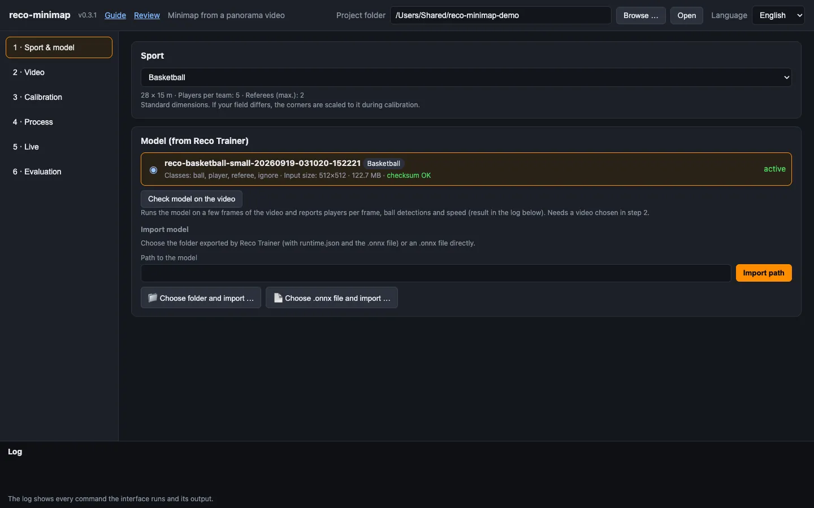
*Step 1: sport chosen, model imported, checksum OK.*

## Step 2 · Video

Choose the **panorama video** (*Browse …* or paste a path). The program reads size, frame rate and length and shows them in green, e.g. `1920×1080, 25 fps, 20:00 min`. A red message means the file could not be read – check that `ffmpeg` is installed.

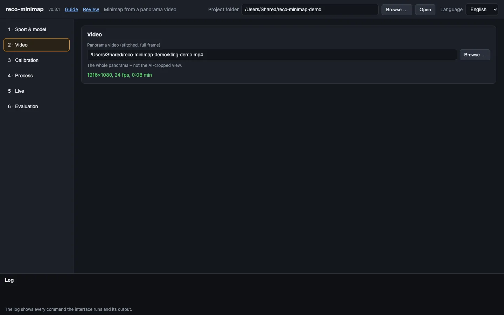
*Step 2: the video has been read – size, frame rate and length appear in green.*

## Step 3 · Calibration

Calibration teaches the program where the field is in the picture. Three things happen here, in this order.

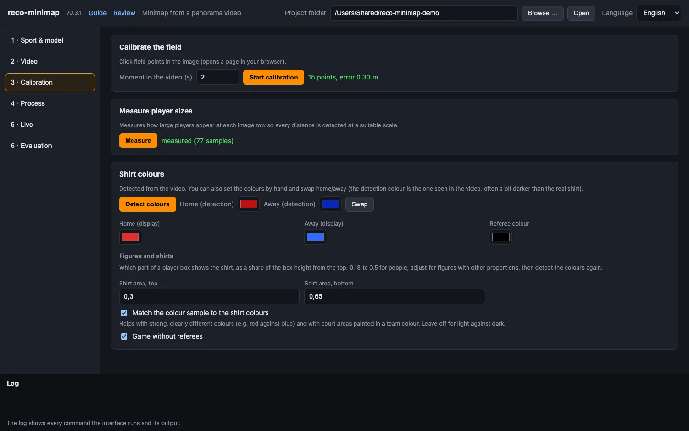
*Step 3 at a glance: calibration (15 points, error 0.30 m), measured player sizes and the shirt colours.*

### 3a · Calibrate the field

1. Set *Moment in the video* to a time where the **whole field is visible** and not blocked by people (for example during a timeout or warm-up).
2. Click *Start calibration*. A page opens in your browser showing that frame.
3. **Click the landmarks in the order listed on the right** (corners, halfway line, centre, penalty/key corners …). The list is in your language.
   * Landmark names use *far* and *near* for the two sidelines (far = away from the camera) and *left/right* as seen in the picture.
   * You do not have to click everything. Skip points you cannot see with the **space bar**.
   * Above the list on the right, a **small top-down field** shows where the landmark being asked for lies: it **blinks orange**. Landmarks already set are green, open ones grey. In this drawing the camera is at the bottom and *far* is at the top.
   * Mouse wheel = zoom, drag = move, **Backspace** = remove the last point, **F** = show the whole picture. The small window top right magnifies the area under the cursor.
4. After the 4th point a **green field drawing** appears over the picture and the page shows the **error in metres**. Add points until the green lines sit on the real lines. Aim for **8 or more points spread over the whole field** and an error **below 0.5 m** (green). More points on different sides matter more than clicking precisely.
5. Click *Save*. Back in the interface the line reads e.g. `15 points, error 0.21 m`.

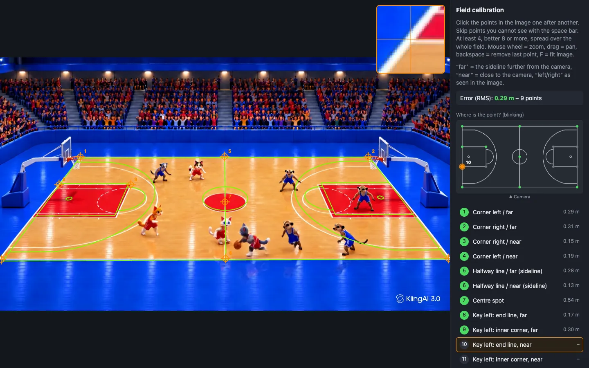
*The calibration page: nine points set, the green lines lie on the field. In the small field sketch on the right, point 10 – the next one – is blinking; the loupe at the top shows the spot under the mouse pointer.*

> An error of 0.00 m after exactly four points means nothing – four points always fit perfectly. Judge the green lines and use more points.

If your venue is not standard size, click only the four corners (and the centre); the other landmarks assume a standard field.

### 3b · Measure player sizes

Click *Measure*. The program looks at a dozen frames and learns how tall a player appears at each image row. Later, each band of the picture is searched with the tile size that suits it (`--tile auto`), which makes detection both better and about twice as fast. It needs the calibration from 3a. Run it once per camera position.

### 3c · Shirt colours

1. Click *Detect colours*. The program samples the shirts of the players on the field and splits them into two teams. The log shows the colour groups it found.
2. Set the colours:
   * **Home / Away (detection)** – the colours as the camera sees them. These are filled in automatically; use *Swap* if home and away are the wrong way round. If it fails ("teams not distinguishable"), pick the two colours by hand with the colour pickers.
   * **Goalkeeper shirts** (football, futsal, handball, hockey, lacrosse) – if the keepers wear a different colour from their team, tick *Goalkeeper shirts*. *Detect colours* proposes the keeper colours from the goal areas; if it is unsure which keeper belongs to which team it says so – then press *Swap goalkeeper colours*. Without this, a keeper in a different shirt is taken for a referee or missed. Basketball and other sports without keeper kits do not show the option. On the minimap the keepers are drawn striped.
   * **Home / Away (display)** – the colours used to draw the dots. Choose what looks right, for example white and a bright blue. A very dark display colour is hard to see on the dark minimap.
   * **Referee colour** – the shirt colour of the referees (usually black or yellow). This lets the program find referees even if the model does not.
3. **Figures and shirts** (change only when needed):
   * **Shirt area, top / bottom** – which part of a player box shows the shirt, as a share of the box height from the top. The default 0.18 to 0.5 fits people. Adjust it for figures with other proportions (mascots, animations), then run *Detect colours* again.
   * **Match the colour sample to the shirt colours** – helps with strong, clearly different colours (red against blue) and when areas of the court are painted in a team colour. Leave it off for light against dark: there it assigns more players to the wrong team.
   * **Game without referees** – nobody is then taken for a referee because of an odd shirt colour.


*Shirt colours and figures: for the cartoon figures of the test video the shirt band sits lower (0.3 to 0.65), and the colour sample leans on red and blue.*

### 3d · Playing direction

For sports with goals or baskets (basketball, football, futsal, handball, hockey, lacrosse): **Home attacks at the start** *left* or *right* (as on the minimap), and if needed **Change of ends at** as video time, e.g. `20:00`. Shots, free throws, corners, penalties and 7 m throws then count for the team attacking that end – even when the shooter's shirt colour was misread. With *Estimate automatically* the statistics derive the direction from the attempts and apply it only when it is clear (at least 6 attempts, 70 % fit). Step 7 shows below the shot chart which direction applies and how many attempts were moved.

## Step 4 · Process

1. **Segments.** Each row is one run: a *Name*, a *Start* and an *End* as `min:s` (or `h:min:s`, or plain seconds). An empty end means up to the end of the video, so you can analyse just a part of a long recording. Splitting a game into quarters is safer – an interruption costs one quarter, not the whole game. *Add segment* adds a row.
2. **Outputs** (tick what you want):
   * *Minimap video* – the minimap on a dark background.
   * *Overlay with transparency (.mov)* – the minimap with a transparent background, to place over a video in an editor or OBS. *Dark backing in the overlay* (0–1) adds a semi-transparent dark box so it stays readable on a bright picture; 0.6 is a good start.
   * *Panorama with boxes and minimap* – your panorama with detection boxes and the minimap in the corner. Use this to **check quality** on your first segment.
   * *Data (.jsonl)* – one record per frame with all positions ([format](../README.md#output-formats)).
3. **Detect on every Nth frame.** 5 is a good default: detection runs on every 5th frame and the minimap video is interpolated to the full frame rate, so it still looks smooth. Higher is faster, lower is more exact.
4. **Opacity of undetected players.** 1 keeps a hidden player fully visible at his estimated position; lower values fade him.
5. **Compute.** *automatic* picks CoreML on a Mac. Leave *CoreML* on `all`.
6. Click **Start**. A window shows the progress (with several sections also which one is running) and, at the end, the files it wrote. *Cancel* asks whether to keep or delete what has been processed so far.

**Where are my files?** In `<project folder>/out/`, named after the segment (`segment1.mp4`, `segment1.mov`, `segment1_pip.mp4`, `segment1.jsonl`). The list below the settings shows the newest files with *Show in folder*.

**Do a quick first run.** Use a segment of 20–60 seconds with *Panorama with boxes and minimap* ticked. Open `…_pip.mp4` and check:

* Do the dots sit on the right people and in the right places on the field? If not, the calibration needs more or better-spread points (step 3a).
* Are there phantom dots or dots that jump? A few jumps are normal; many point to a poor calibration or colours that are too similar.
* Are the referees marked? If not, check the referee colour (step 3c).

Then process the whole game.

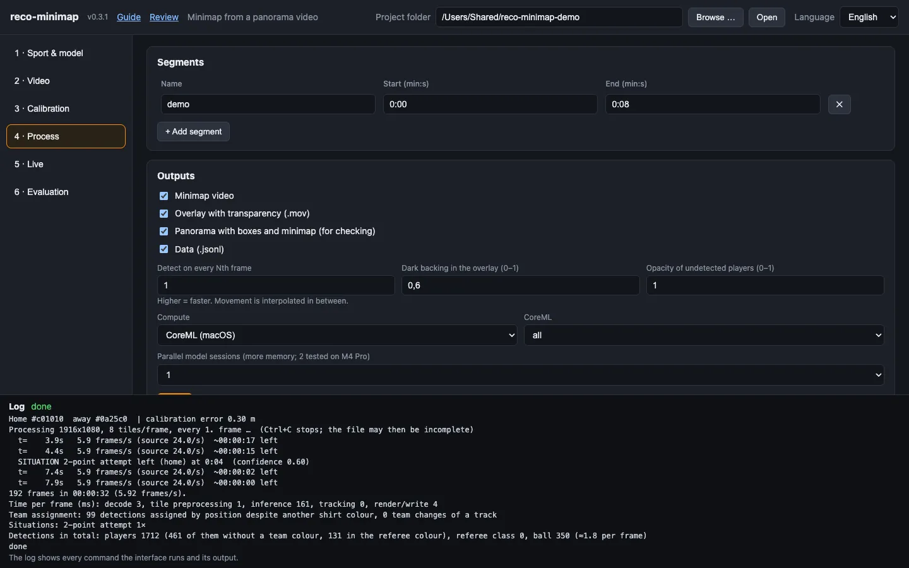
*Step 4: one segment (0:00 to 0:08), all four outputs ticked. The log at the bottom shows the summary of the run.*

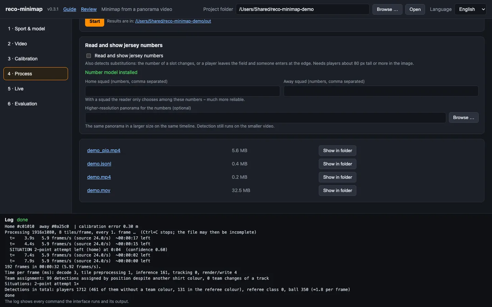
*The finished files below the Start button: the file name opens the file, *Show in folder* selects it in the Finder, the folder path opens the results folder.*

### Jersey numbers (optional)

In step 4 there is a section *Read and show jersey numbers*.

1. Click *Download model* once (about 11 MB). The status turns to "Number model installed".
2. Enter the **squad numbers** of both teams, separated by commas (`4,7,10,12,23`). The reader then only chooses among these – much more reliable. In football, handball, hockey and the like, mark the goalkeepers with `g` behind the number (`1g,4,7,12g`): once the goalkeeper kit colour is set (step 3c), a keeper's number is then searched only among the keepers and everyone else's only among the outfield players.
3. Tick *Read and show jersey numbers* and run a segment.
4. **Size matters.** A number is readable from roughly 10 px digit height, which means players about **80 px tall**. At the end of the run the log says how tall players are in your video and whether that is enough. If not, export a larger version of the same panorama with Reco (same timeline, same frame rate) and enter it as *Higher-resolution panorama for the numbers*. Detection keeps using the smaller video.
5. Numbers appear on the dots as soon as they are confirmed. Players whose back is never visible stay without a number.

**Substitutions** show up in the log (`SUBSTITUTION home at 12:34: #7 -> #12` for a confirmed change, "possible substitution" when someone left and someone entered at the sideline but numbers are unknown), in `events` of the data file and in step 6.

### Game situations (optional)

Tick *Detect game situations* (in step 4, also available in step 5). The program then recognises the **formations at stoppages** and, in basketball, **shot attempts**:

* Basketball: tip-off, free throw, throw-in (inbound), 2- and 3-point attempts, substitutions.
* Football: kick-off, penalty, corner, throw-in, substitutions.
* Handball: throw-off, 7 m throw, throw-in, substitutions.
* Futsal, hockey, rugby, lacrosse: see the [catalogue per sport](SCENARIOS.md).

What to expect:

* A situation is reported when the formation has held for a moment – for example a player at the free-throw line, three players in the lane, everybody else standing still. The log then says e.g. `SITUATION free throw left (home) at 12:34 (confidence 0.85)`.
* **Check it on a short segment first** and compare with the video. Thresholds are first estimates; a throw-in can be reported when a player simply stands at the line, and a situation is missed when many players are not detected.
* **2- and 3-point attempts** need the ball to be found when it leaves the shooter's hands. They tell you the type of attempt, not whether it scored. A "close to the line" note means the position error is as large as the distance to the 3-point line.
* The scenes appear in the data file as events with `"type": "scene"` and in step 6.

## Step 5 · Live (optional)

The live mode serves a transparent overlay page for OBS while the video plays. It is meant for streams; for post-production use the `.mov` overlay from step 4.

1. *Source*: a file, or a stream address (`srt://…`, `rtmp://…`, `udp://…`). For a first test choose a video file and tick *Play file in real time*.
2. Enter *Size* (for example `1920x1080`) and *Frames/s*. Keep the port (8765) unless it is taken.
3. Click *Start live*. The page shows the overlay address, e.g. `http://127.0.0.1:8765/`.
4. **In OBS:** add a *Browser* source, paste the address, set width 1400 and height 800. The background is transparent.
5. Open the address with `?floor=1&debug=1` in a normal browser to test without OBS (dark floor, status line).
6. *Stop* ends it.

The live mode needs the same full panorama you calibrated on, not the AI-cropped view.

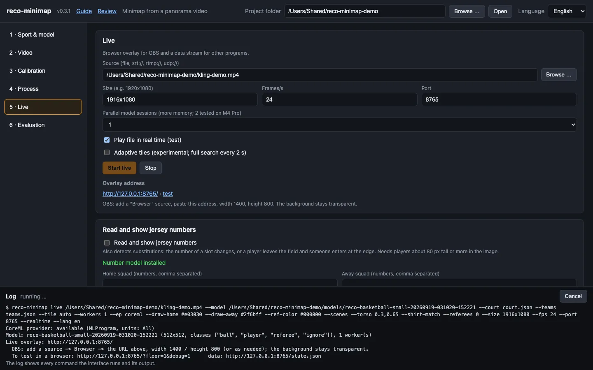
*Step 5 during a live run: *Overlay address* shows the address for OBS and a test link.*

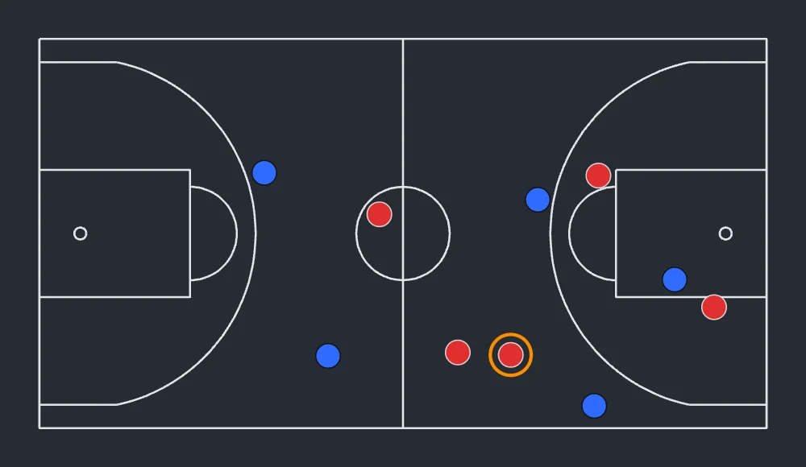
*The live overlay with `?floor=1` (dark floor for testing); in OBS the background is transparent. The orange ring marks who has the ball.*

## Step 6 · Evaluation

Steps 6 and 7 both work with the data files (`.jsonl`) in `out/`, but look at different things: **step 6 checks the detection** – how reliably players, referees and the ball were tracked. **Step 7 shows the game** – attempts, possession and where the teams were. Look at step 6 first: if its values are poor, the numbers in step 7 are uncertain too.

### Detection report

Under *Evaluation* choose a `.jsonl` file and click *Evaluate*. The report appears in the progress window and in the log and answers:

| Line | Good looks like |
|---|---|
| `exactly 5+5 in …% of the frames` (basketball) | above 70 % |
| `Distinct player IDs: home …, away …` | at most about 8 per team (more means slots are often reassigned) |
| `Visible (not hidden/lost): …%` | above 85 % |
| `steps at the speed limit` | under 3 % |
| `2 referees in …%` | high, if referees are on the field |
| `Ball: held / in flight / loose / unknown` | the share of *unknown* shows how often the ball was not found; with a weak ball model it can be high |
| `Substitutions: …` | the list of substitutions with time and numbers |
| `Situations: …` | each detected situation with time, team and confidence – compare a few with the video |

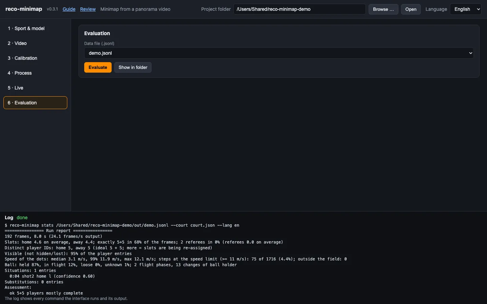
*Step 6: the report on the data file in the log.*

### Tactics board

Under *Tactics board* you stop a result at a *Moment* (e.g. `12:30`) and open that moment as a tactics board: all players and the ball stand where they were at that time, *Trail (s)* draws the last seconds of their paths. On the board you can move players, draw and save; a board you saved for the same moment opens again as you left it. More in [Tactics board scenes](../README.md#tactics-board-scenes).


## Step 7 · Statistics

Choose a `.jsonl` file from `out/` at the top. The statistics follow the sport of the calibration (`court.json`) and need that calibration. **Attempts** are counted – whether a shot went in is not something the detection can see. Every dot, cell and bar shows its exact values when the mouse rests on it.

### Key figures

The tiles at the top show attempts per team, **possession** (share of the time a player of the team holds the ball), *Ball seen* (in what percentage of the frames the ball was found) and the duration with start and end time in the video. If *Ball seen* is low, possession and attempts have gaps.

### Shot chart / shot map

In basketball the card is called *Shot chart*, in football, futsal, handball, hockey and lacrosse *Shot map*. Every attempt stands at its place on the field in the team colour; the shape shows the kind (circle 2 points or shot, diamond 3 points, triangle free throw or 7 m). *Both / Home / Away* filters, *Table* shows the same attempts as a list with time, team, kind, zone and distance.

* **Basketball:** the shots come from game-situation detection – it must have been on while processing (step 4).
* **Goal sports:** an attempt is a fast ball flight that starts within shooting range and points at a goal.

### Attempts by zone

On the left a heat map of the attempts: the field is split into cells of about 2 × 2 m, the darker a cell, the more attempts came from there. On the right the share of every zone as a bar with its count (basketball: restricted area, paint, mid-range, corner 3, above-the-break 3, free throw; football: goal area, penalty area, outside; handball: 6 m, wing, back court, 7 m; futsal, hockey and lacrosse by distance). The *Both / Home / Away* filter applies here too.

### Attempts per time section

The video is split into sections of equal length (four in basketball and hockey, otherwise two); bars per team and below them the difference home – away per section. The program knows no game clock: stoppages count, and a section is not the same as a quarter or half unless the video is exactly one period.

### Possession and ball on the field

A bar splits the time with possession between home and away. For field sports, *Ball on the field* shows how long the ball was in the left third, the middle and the right third – "left" and "right" as in the camera picture.

### Position heat map

The *Positions* card is a heat map: it shows where a team or the ball was during the video.

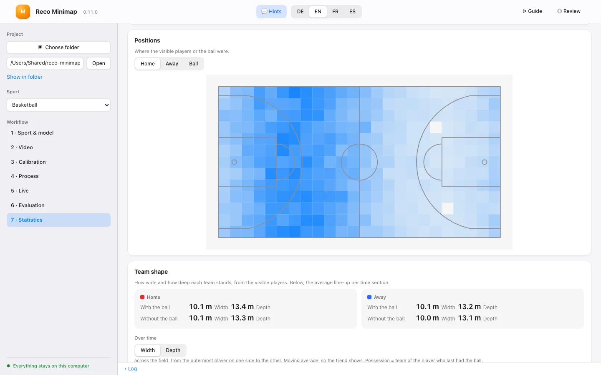
*Step 7: position heat map, with the Home / Away / Ball choice at the top.*

* **Switching:** *Home*, *Away* or *Ball* chooses whose positions are shown. Teams appear in the accent colour, the ball in orange.
* **How it is made:** the field is split into 24 cells along its length and a matching number across. For every frame each cell counts how many players of the team stood in it (or whether the ball lay in it). Only **visible** players with a team count – estimated positions of hidden players, referees and players without a team colour do not. The ball only counts in frames where it was found.
* **How to read it:** the stronger a cell, the more time; the strongest cell is the most visited one and the others are measured against it. Empty cells stay blank. Rest the mouse on a cell to see its share of all counted positions in percent.
* **What for:** where does a team defend, how high does it stand, which side does it attack on, where does the ball spend the most time? Compare *Home* and *Away* in the same section, or two sections of the same team (e.g. first and second half as separate files).
* **Limits:** players far from the camera are detected less often, so the far side often looks paler. Teams changing ends at half time mix if both halves are in one file. Positions outside the field do not count.

### Team shape

The *Team shape* card shows how wide and how deep each team stands. It only uses the player positions, so it needs no goal or shot detection.

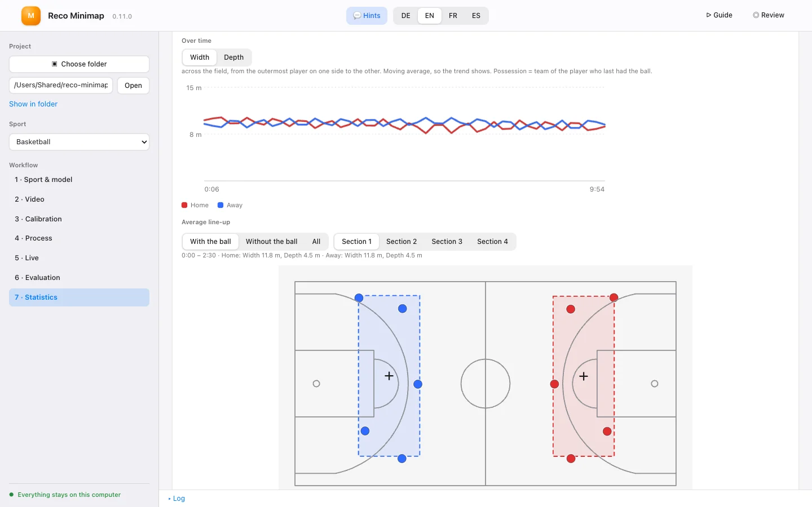
*Step 7: team shape, the width over time at the top, the average line-up with the ball in section 1 below.*

* **Width and depth:** *Width* is measured across the field from the outermost player on one side to the one on the other, *depth* along the field. When 7 or more players of a team are visible, the player farthest from the team (usually the goalkeeper) is left out of the depth. A frame only counts when at least 3 players of the team are visible.
* **With / without the ball:** At the top you see each team's averages, split by possession. Possession means: the team of the player who last had the ball. Without possession detection (for example in sports where the program does not determine a ball carrier) there is only *All*.
* **Over time:** width or depth over time as a moving average, so the trend shows. Rest the mouse on the chart to see both teams' values at that time.
* **Average line-up:** For each time section, and for *With the ball*, *Without the ball* or *All*, the field shows the average position of every player slot, the team centre (+) and a rectangle of the average width and depth. Slots visible in less than a fifth of the section are left out.
* **What for:** Does a team stand tighter in section 3 than at the start? How much does it close up without the ball, how wide does it make the field with it?
* **Limits:** The values describe the team, not single players: without jersey numbers two player slots can swap people, and the average line-up then blurs. Players far from the camera are found less often, which can underestimate the width.

### Key moments and clips

The list shows attempts, game situations and confirmed substitutions with time, team and zone. Tick moments (*All* selects all) and click *Cut clips*: each gets a short clip from the video in `out/clips/`, from 6 s before to 4 s after the moment. *Show clips* opens the folder. The video from step 2 must still be in the same place.

### Live ticker simulation

What would the live ticker have reported for this video? The card shows entries, entries per 10 minutes, confirmed and possible substitutions, game situations and the longest silence. *Simulate live ticker* creates `liveticker.json` (or tick the output *Live ticker file* in step 4), *View ticker* shows the page as viewers would have seen it. So you know before a game whether the ticker is worth it. Team names and display (numbers/names) come from step 5.

---

## Updating

**Mac app:** when a new version is out, the app asks at start: *Version … is available. Install now?* It downloads the update, checks its signature, switches over and restarts; your projects stay as they are. While a task is running, the update waits. By hand: menu *Reco Minimap → Check for Updates…*.

**Windows and Linux zip:** download the new zip from the release page and unpack it.

**Built yourself (cargo):** as described below.

When it starts, the interface asks GitHub once whether a newer version exists. Only the request itself is sent, no video, frame or project data.

* If there is one, a **blue notice** appears at the top with the version number, a *What's new?* link and the button *Install now*.
* *Install now* fetches the source of that version and rebuilds the program. This takes a few minutes and needs the same Rust installation you used to install the program. The log shows the progress.
* Afterwards stop the program in the terminal with **Ctrl+C** and start it again.

On the command line: `reco-minimap update` tells you whether there is something new; `reco-minimap update --yes` installs it. Switch the check at start-up off with `reco-minimap ui --no-update-check`.

## Using the results

**Put the minimap into a game video with ffmpeg** (overlay `segment1.mov` onto `game.mp4`, bottom right, 480 px wide):

```bash
ffmpeg -i game.mp4 -i out/segment1.mov \
  -filter_complex "[1:v]scale=480:-1[m];[0:v][m]overlay=W-w-30:H-h-30:format=auto" \
  -c:v libx264 -crf 18 -pix_fmt yuv420p -c:a copy game_with_minimap.mp4
```

The overlay starts at the segment's start time; use `-ss` on the game video if your segment did not begin at zero. For whole games in several segments, `scripts/run_game.sh` does the processing and the compositing for you.

**Use the data** (`.jsonl`) in your own analysis; the format is in the [README](../README.md#output-formats).

---

## When something goes wrong

| Message or symptom | What to do |
|---|---|
| *ONNX Runtime library not found* / red banner at the top | Set `ORT_DYLIB_PATH` to the `libonnxruntime…dylib` (version 1.24 or newer) and start `reco-minimap ui` from that same terminal. See [Install](../README.md#install). |
| *CoreML provider is not included* | Use the library from the Python wheel (`pip install onnxruntime`), not the Homebrew one – or set *Compute* to `CPU`. |
| *ffmpeg not found* | `brew install ffmpeg` |
| Nothing happens on *Browse …* | The file dialogs need macOS (or `zenity` on Linux). Paste the path instead. |
| `zsh: command not found: #…` | Do not paste lines starting with `#` into the terminal – zsh does not treat them as comments. |
| *Detect colours* fails | Check the calibration (only players inside the calibrated field are counted) and set the colours by hand. |
| Few players detected | Run *Measure* (3b). The program already follows a player on uncertain detections (from 0.30) but only starts a dot on a confident one (from 0.60); if the model is uncertain throughout on your footage, lower `--thr-player` on the command line (e.g. 0.5). A small or blurry picture limits the model. |
| Ball rarely found (default model) | The general model of Reco camera is less sure of the ball. Import a model trained in Reco Trainer for the sport and choose it in step 1. With the default model lower thresholds apply (players from 0.35, ball from 0.20). |
| *Download model* fails | It needs a connection to GitHub once. If you already have `yolo26n.onnx` (e.g. from Reco camera): `reco-minimap fetch-model --from /path/to/yolo26n.onnx`. |
| Team colours wrong, or dots in the wrong colour | Set the colours by hand in 3c. For strong colours or coloured court areas switch on *Match the colour sample to the shirt colours*. |
| Two "referees" although there are none | Switch on *Game without referees* in 3c. |
| Dots are in the wrong place | Calibrate again with more points spread over the whole field; the green field drawing must sit on the real lines. |
| Referees missing | Set the referee shirt colour (3c). |
| Very slow | Use *Detect on every Nth frame* with a higher N; make sure *Compute* is CoreML; run *Measure* so that fewer tiles are needed. |
| Numbers stay empty | Is the number model installed? Are players tall enough (see the summary at the end of a run)? Did you enter the squad lists? |
| The port is taken | Start with `reco-minimap ui --port 8800`. |

Still stuck? Open the log (bottom of the page) – it shows the exact command that was run (`$ reco-minimap …`). You can paste it into a terminal to see the same output with more detail.
